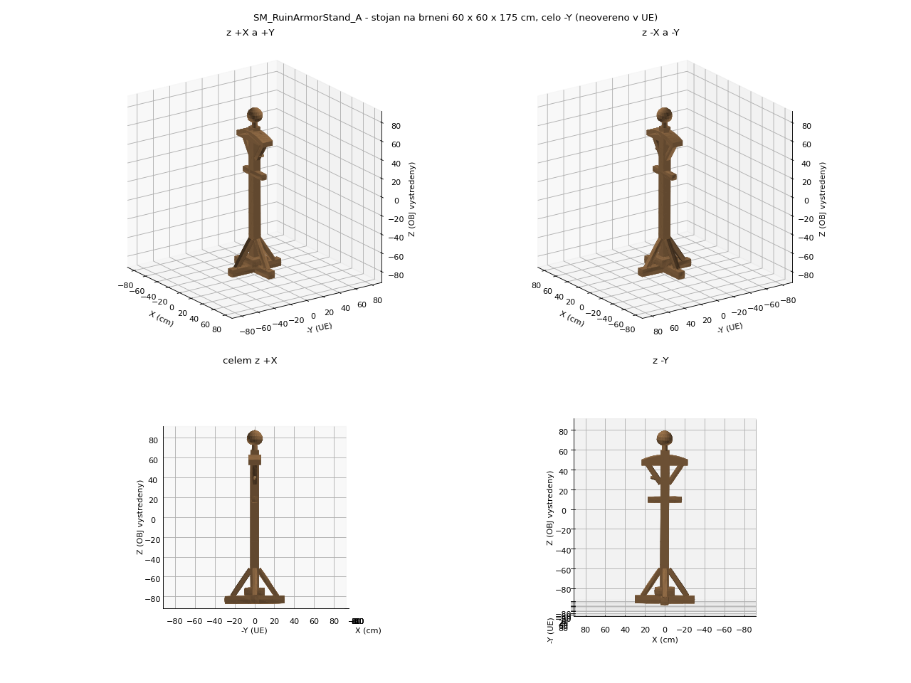

---
# orchestrace
type: asset
asset_status: imported
requested_by: Furnisher
requested: 2026-11-21
owner: Crafter
priority: medium
depends_on: []
superseded_by:
updated: 2026-11-23
aliases: ["SM_RuinArmorStand"]
# hra
asset_kind: mesh
asset_category: props
used_by: ["[[Guesthouse]]"]
envelope: [61, 61, 175]
stand_in: none
asset_source: tools/meshes/mesh_props.py:armor_stand
ue_path: /Game/Skvt/Lapikus/Ruin/Props/SM_RuinArmorStand_A
variants: []
---
# SM_RuinArmorStand_A

## Účel a použití
Stojan na brnění v Guesthouse (graybox `GH_ARMOR`, u hradby na severozápadě), zatím prázdný; varianta A (Jirka 22. 11. 2026); `shape: armor_stand`, `finish: oil`. Brnění = samostatný mesh posazený na body stojanu.

Osy: **čelo −Y** (zády ke zdi), kolík na rukavice +X; pivot ve středu bounding boxu. Společná pravidla: [[Konvence_assetu]].

## Požadavek

## Na míru
Body pro brnění `mesh_props.ARMOR_STAND_POINTS` v cm od podlahy, osa sloupku x = y = 0: hlava 167, ramena 150, pás 105, kolík (10; 0; 126). V lokálních osách meshe (pivot ve středu) je od výšek odečíst 87,3 cm.

## Z kódu
Ručně do etapy B (P20, `asset_sources.yaml`), stav kódu 2026-11-23:
- rozměr (bounding box OBJ `meshes/props/`): 60,1 × 60,3 × 175,0 cm
- varianty v UE: `SM_RuinArmorStand_A`
- sloty: `wood`, `endgrain`; výchozí materiál dílce `wood`
- verze: `STONE_MESH_VERSION["SM_RuinArmorStand"]` = 3; `MESH_AXES` = 10

## Stav v UE
Ručně do etapy C (`ue_query --assets`): `.uasset` je v `Content/Skvt/Lapikus/Ruin/Props/` (v gitu, 2026-11-23); verze v UE a vzhled neověřeny.
Verze 3 (léta podél délky dílů) čekala 22. 11. 2026 na nový import ([[Katalog_props]], *Stav*).

## Vizuálně ověřeno
<!-- verified (jen GameDesigner): kdo, kdy (RRRR-MM-DD), verze -->

## Poznámky
- Konstrukce: kříž noh 60 × 60 z přeplátovaných trámků se vzpěrami a patkou, sloupek 9 × 9, klenuté ramenní jařmo 46 cm se dvěma vzpěrami (unese plátovou zbroj), pásová příčka 34 cm, krček a ručně točená hlavice; léta podél délky všech dílů (`grain="long"`).
- Jařmo opravené ve verzi 2 (screenshot 22. 11. 2026); léta sloupku napříč (verze 2) opravena ve verzi 3.
- Převedeno z [[Katalog_props]] a [[CHECKLIST_assets_navrhy]] kap. 6.8 při zavedení karet (P19, Steward, 2026-11-23); stav podle kódu a `.uasset`, potvrdí Crafter. `requested_by` a `requested` doplněny podle role, která asset používá, a data v checklistu.
