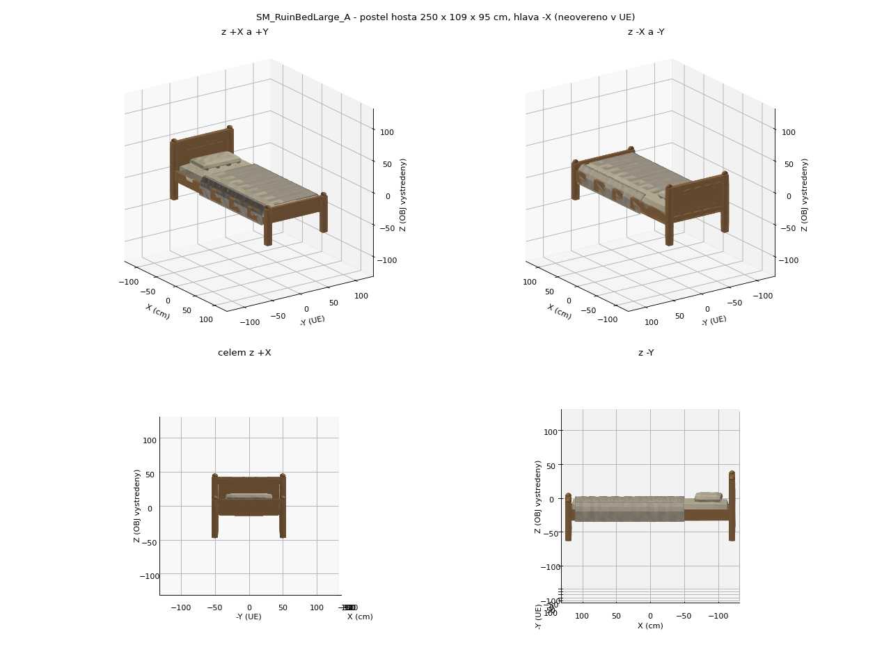

---
# orchestrace
type: asset
asset_status: imported
requested_by: Furnisher
requested: 2026-11-21
owner: Crafter
priority: medium
depends_on: []
superseded_by:
updated: 2026-11-23
aliases: ["SM_RuinBedLarge"]
# hra
asset_kind: mesh
asset_category: props
used_by: ["[[Guesthouse]]"]
envelope: [251, 110, 95]
stand_in: none
asset_source: tools/meshes/mesh_props.py:bed_large
ue_path: /Game/Skvt/Lapikus/Ruin/Props/SM_RuinBedLarge_A
variants: []
---
# SM_RuinBedLarge_A

## Účel a použití
Pohodlná postel hosta v Guesthouse (graybox `GH_BED` 2,50 × 1,09 m, ověřený s postavou 180 cm); `shape: bed_large`, `finish: oil`. Kvalitnější nábytek než v domě, ručně a hrubě opracovaný (Jirka 22. 11. 2026). Rozmístěna 22. 11. 2026 místo grayboxu, hlava u jižního rohu (s = 1,85), nohy k truhle.

Osy: X podél postele, **hlava −X** (čelo 95 cm), nohy +X; pivot ve středu bounding boxu. Společná pravidla: [[Konvence_assetu]].

## Požadavek

## Na míru

## Z kódu
Ručně do etapy B (P20, `asset_sources.yaml`), stav kódu 2026-11-23:
- rozměr (bounding box OBJ `meshes/props/`): 250,2 × 109,1 × 95,0 cm
- varianty v UE: `SM_RuinBedLarge_A`
- sloty: `wood`, `wool`, `canvas`; výchozí materiál dílce `wood`
- verze: `STONE_MESH_VERSION["SM_RuinBedLarge"]` = 2; `MESH_AXES` = 10

## Stav v UE
Ručně do etapy C (`ue_query --assets`): `.uasset` je v `Content/Skvt/Lapikus/Ruin/Props/` (v gitu, 2026-11-23); verze v UE a vzhled neověřeny.
Verze 2 (léta sloupků) čekala 22. 11. 2026 na nový import ([[Katalog_props]], *Stav*).

## Vizuálně ověřeno
<!-- verified (jen GameDesigner): kdo, kdy (RRRR-MM-DD), verze -->

## Poznámky
- Konstrukce: sloupky 9 × 9 se zkosenými hranami a hlavicí; čelo v hlavě 95 cm (rám, vložená deska, římsa), čelo v nohách 62 cm; bočnice 16 cm, lišty, 9 laťek; slamník 20 cm a polštář v lněném potahu (`Canvas`), houně přes bočnice. Nižší čelo = parametr `head_h`.
- Funkční: ložná plocha 55 cm nad podlahou, bočnice nahoře 46 cm.
- Verze 2: sloupky a hlavice s léty svisle (`grain="long"`), ostatní díly zatím původní UV (T-0024, *Změny konvence* v [[Konvence_assetu]]).
- Graybox `GH_BED` měl výšku 0,62 m; mesh je vyšší jen čelem v hlavě (95 cm) ❓ (z katalogu).
- Převedeno z [[Katalog_props]] a [[CHECKLIST_assets_navrhy]] kap. 6.8 při zavedení karet (P19, Steward, 2026-11-23); stav podle kódu a `.uasset`, potvrdí Crafter. `requested_by` a `requested` doplněny podle role, která asset používá, a data v checklistu.
