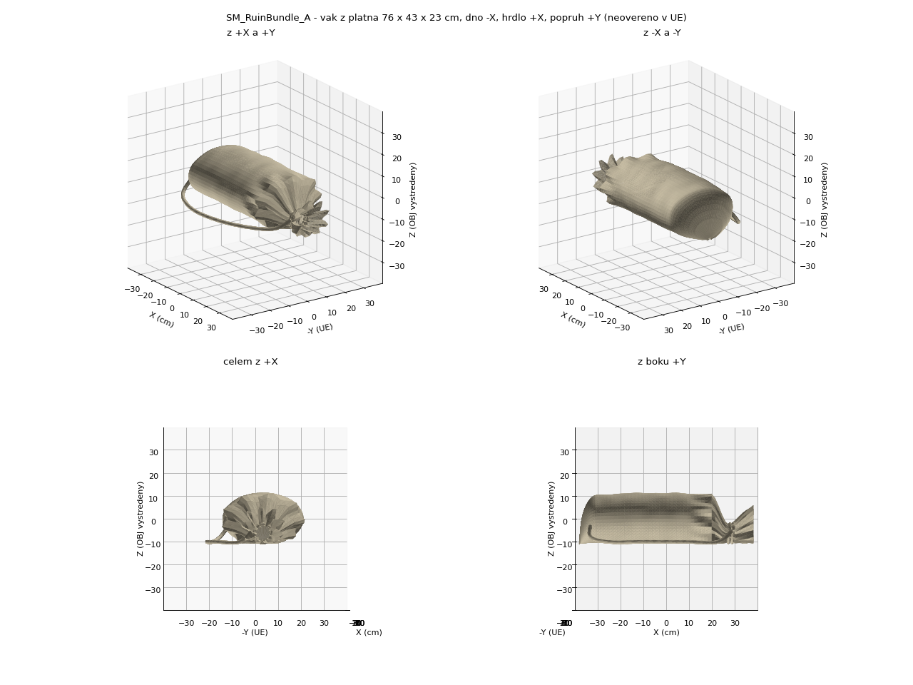

---
# orchestrace
type: asset
asset_status: imported
requested_by: legacy
requested:
owner: Crafter
priority: medium
depends_on: []
superseded_by:
updated: 2026-11-24
aliases: ["SM_RuinBundle"]
# hra
asset_kind: mesh
asset_category: props
used_by: ["[[Nadvori_Stan]]"]
envelope: [76, 44, 23]
stand_in: none
asset_source: tools/meshes/mesh_props.py:bundle
ue_path: /Game/Skvt/Lapikus/Ruin/Props/SM_RuinBundle_A
variants: []
---
# SM_RuinBundle_A

## Účel a použití
Vak (ranec) z plátna ležící na boku, pohozený o kus vedle lůžka; vak asi 62 × Ø 30 cm, popruh přes rameno; `shape: bundle`, materiál pevný (`MI_RuinSackcloth`: zažloutlé plátno, hustší skvrny, zaprášený vršek; Jirka 22. 11. 2026).

Osy: **dno −X, hrdlo +X** (stažené dvěma závity lana, roztřepený okraj), popruh leží volně na zemi na straně +Y; pivot ve středu bounding boxu. Společná pravidla: [[Konvence_assetu]].

## Požadavek

## Na míru

## Z kódu
<!-- hestia:generated:start -->

<!-- hestia:asset_code -->
- Rozměr (skutečný): 76 × 43.4 × 22.5 cm; `envelope` 76 × 44 × 23 cm: vejde se
- Varianty: `SM_RuinBundle_A`
- Sloty: ['rope', 'sackcloth']
- Výchozí materiál: `sackcloth`
- Verze: 2 (prefix `SM_RuinBundle`, `RuinStoneVersion`)
- Globální verze: `MESH_AXES` 10
- `ue_path` (odvozená): `/Game/Skvt/Lapikus/Ruin/Props/SM_RuinBundle_A.SM_RuinBundle_A`
- `.uasset` na disku: ano
- Zdroj: `PrototypeDesigns/Lapikus/zrlib/config.py:272`
- Data: `PrototypeDesigns/Lapikus/06_furnishing/furnishing.json` ([[Lapikus]])

<!-- hestia:generated:end -->

## Stav v UE
<!-- hestia:generated:start -->

<!-- hestia:asset_ue -->
Čtení z UE: `Maintenance/reports/ue_assets.json` · etapa 1 (skript v editoru) (datum čtení u každého assetu)

- `SM_RuinBundle_A` (čteno 2026-11-23): v UE ano (`/Game/Skvt/Lapikus/Ruin/Props/SM_RuinBundle_A.SM_RuinBundle_A`) · `RuinStoneVersion` 2 (kód 2) · `RuinMeshAxes` 10 (`MESH_AXES` 10) · current

<!-- hestia:generated:end -->

## Vizuálně ověřeno
<!-- verified (jen GameDesigner): kdo, kdy (RRRR-MM-DD), verze -->

## Poznámky
- Pomocná funkce `_rope` (lano podél křivky, prameny jako `SM_RuinRope`).
- Převedeno z [[Katalog_props]] a [[CHECKLIST_assets_navrhy]] kap. 6.5 při zavedení karet (P19, Steward, 2026-11-23); stav podle kódu a `.uasset`, potvrdí Crafter. `requested_by: legacy` (vyrobeno před zavedením karet, CR-036).
