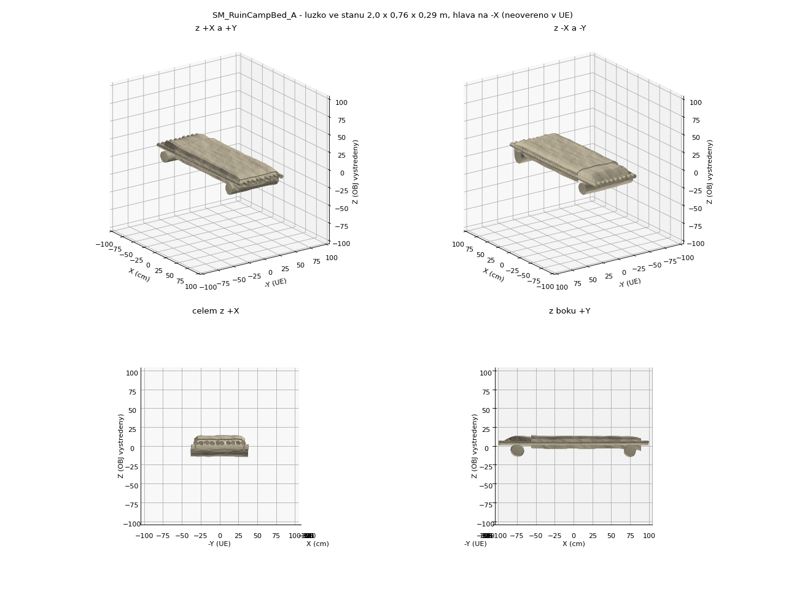
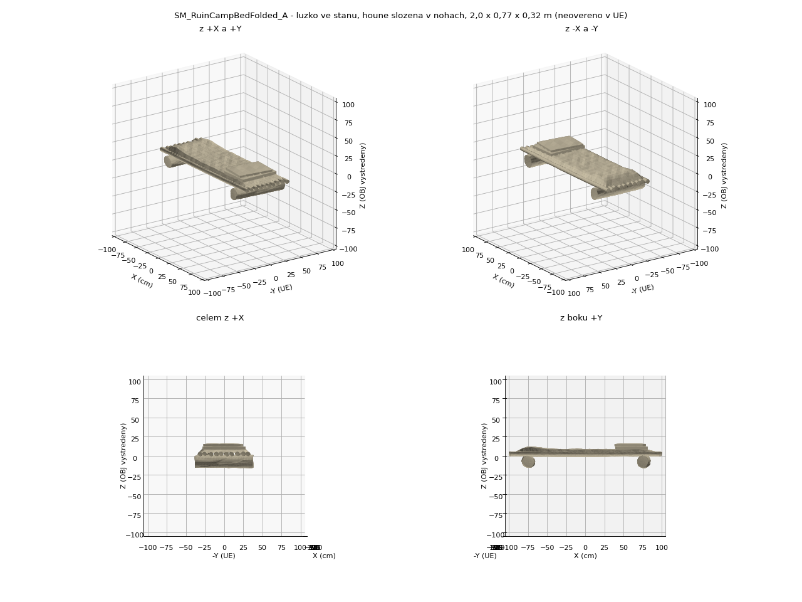

---
# orchestrace
type: asset
asset_status: imported
requested_by: Furnisher
requested: 2026-11-21
owner: Crafter
priority: medium
depends_on: []
superseded_by:
updated: 2026-11-23
aliases: ["SM_RuinCampBed"]
# hra
asset_kind: mesh
asset_category: props
used_by: ["[[Nadvori_Stan]]"]
envelope: [200, 77, 33]
stand_in: none
asset_source: tools/meshes/mesh_props.py:camp_bed (folded=False/True)
ue_path: /Game/Skvt/Lapikus/Ruin/Props/SM_RuinCampBed_A
variants: [SM_RuinCampBedFolded_A]
---
# SM_RuinCampBed_A

## Účel a použití
Lůžko ve stanu z klád a tyčí, výplň sláma a houně; `SM_RuinCampBed_A` houně přes slámu (`shape: camp_bed`), tvarová varianta `SM_RuinCampBedFolded_A` houně složená v nohách (`camp_bed_folded`); `finish: raw`. Ve stanu jedno lůžko na straně zavřené chlopně, hlavou k zadnímu štítu, vnější okraj asi 0,9 m od osy stanu (plachta tam 35 cm nad zemí).

Osy: X podél lůžka, **hlava −X**; pivot ve středu bounding boxu. Společná pravidla: [[Konvence_assetu]].

## Požadavek

## Na míru

## Z kódu
Ručně do etapy B (P20, `asset_sources.yaml`), stav kódu 2026-11-23:
- rozměr (bounding box OBJ `meshes/props/`): 198,8 × 76,2 × 28,8 cm (SM_RuinCampBed_A); 200,0 × 76,5 × 32,1 cm (SM_RuinCampBedFolded_A)
- varianty v UE: `SM_RuinCampBed_A`, `SM_RuinCampBedFolded_A`
- sloty: `wood`, `endgrain`, `bark`, `straw`, `wool`; výchozí materiál dílce `wood`
- verze: `STONE_MESH_VERSION["SM_RuinCampBed"]` = 1; `MESH_AXES` = 10

## Stav v UE
Ručně do etapy C (`ue_query --assets`): `.uasset` všech 2 variant v `Content/Skvt/Lapikus/Ruin/Props/` (v gitu, 2026-11-23); verze v UE a vzhled neověřeny.

## Vizuálně ověřeno
<!-- verified (jen GameDesigner): kdo, kdy (RRRR-MM-DD), verze -->

## Poznámky
- Konstrukce: 2 příčné klády s kůrou Ø 15 × 75 cm (26 a 24 cm od konců), 10 tyčí s kůrou Ø 5 × 200 cm, sláma (pod hlavou o 3 cm víc), houně s převisem 10 cm; pomocná funkce `_pole`.
- Funkční: vrch slámy asi 25 cm nad zemí.
- Převedeno z [[Katalog_props]] a [[CHECKLIST_assets_navrhy]] kap. 6.5 při zavedení karet (P19, Steward, 2026-11-23); stav podle kódu a `.uasset`, potvrdí Crafter. `requested_by` a `requested` doplněny podle role, která asset používá, a data v checklistu.
