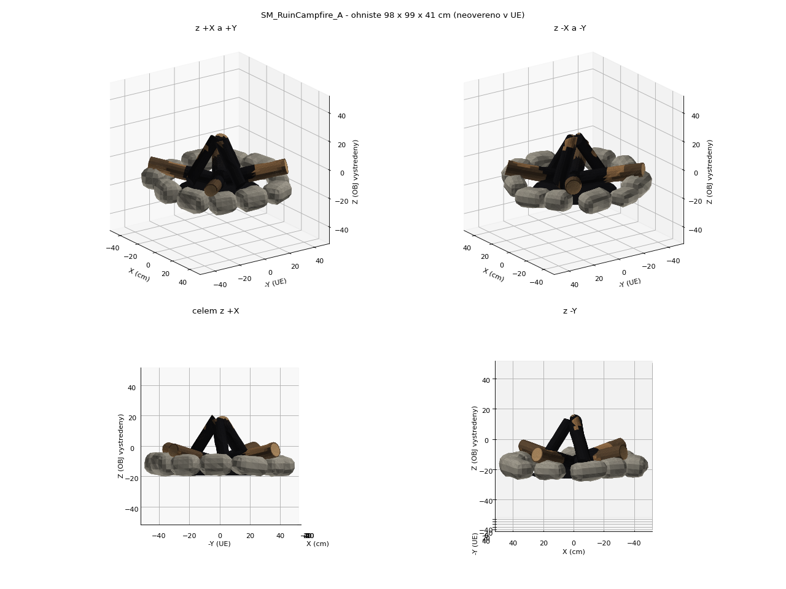

---
# orchestrace
type: asset
asset_status: imported
requested_by: GameDesigner
requested: 2026-11-25
owner: Crafter
priority: medium
depends_on: []
superseded_by:
updated: 2026-11-25
aliases: ["SM_RuinCampfire"]
# hra
asset_kind: mesh
asset_category: props
used_by: []
envelope: [99, 99, 41]
stand_in: none
asset_source: tools/meshes/mesh_props.py:campfire
ue_path: /Game/Skvt/Lapikus/Ruin/Props/SM_RuinCampfire_A
variants: []
---
# SM_RuinCampfire_A

## Účel a použití
Jednoduché ohniště: kruh kamenů, uvnitř polena, která hoří, takže jejich středy jsou zčernalé (zadání Jirky 25. 11. 2026). Zatím bez určeného místa (`used_by` prázdné); `shape: campfire`, `finish: raw` (konce polen mimo oheň).

Osy: souměrné, bez čela; pivot ve středu bounding boxu, spodek na zemi (z = 0, polena a kameny místy ~1 cm pod). Společná pravidla: [[Konvence_assetu]].

## Požadavek
Ohniště obehnané kameny, dřevo uvnitř hoří a středy polen jsou zuhelnatělé (Jirka 25. 11. 2026). Rozměr nezadán, graybox není.

## Na míru
Střed ohně je v ose meshe (x = y = 0); plamen pro budoucí VFX asi 5–40 cm nad zemí. Oheň ani žhnutí mesh nemá (emisivní materiál nebo Niagara, zatím nezadáno).

## Z kódu
<!-- hestia:generated:start -->

<!-- hestia:asset_code -->
- Rozměr (skutečný): 98.1 × 98.8 × 40.7 cm; `envelope` 99 × 99 × 41 cm: vejde se
- Varianty: `SM_RuinCampfire_A`
- Sloty: ['wood', 'endgrain', 'bark', 'charcoal', 'face']
- Výchozí materiál: `wood`
- Verze: 1 (prefix `SM_RuinCampfire`, `RuinStoneVersion`)
- Globální verze: `MESH_AXES` 10
- `ue_path` (odvozená): `/Game/Skvt/Lapikus/Ruin/Props/SM_RuinCampfire_A.SM_RuinCampfire_A`
- `.uasset` na disku: ano
- Zdroj: `PrototypeDesigns/Lapikus/zrlib/config.py:276`
- Data: bez výskytu

<!-- hestia:generated:end -->

## Stav v UE
Import proběhl při ukázce (`Ukazka_Ohniste.py`, 25. 11. 2026): `.uasset` v `Content/Skvt/Lapikus/Ruin/Props/SM_RuinCampfire_A.uasset`, verze 1. Čtení z UE (`ue_query --assets`) zatím neproběhlo, generovaný blok doplní.
<!-- hestia:generated:start -->
<!-- hestia:generated:end -->

## Vizuálně ověřeno
<!-- verified (jen GameDesigner): kdo, kdy (RRRR-MM-DD), verze -->

## Poznámky
- Konstrukce: 11 zaoblených kamenů v kruhu (vnější Ø ~1,0 m, vnitřní ~0,6 m), nízké lože uhlí a popela, 4 polena hvězdicovitě (vnější konce na kamenech) a 3 polena opřená do stanu (vrch ~38 cm). Středy polen v ohni přebarvené na slot `Charcoal` podle vzdálenosti od středu (zubatý okraj, vršky stanu a vnější konce zůstávají dřevo s kůrou).
- Sloty: `Wood`, `EndGrain`, `Bark`, `Charcoal` (`MI_RuinCharcoal`), `Face` (kameny = `MI_RuinFace`). Slot `Face` přidán s tímto assetem (25. 11. 2026, [[Konvence_assetu]] kap. *Materiály*).
- Ukázka v UE: `tools/meshes/ukazka/Ukazka_Ohniste.py` (téma `ohniste`).
- Vyrobeno 25. 11. 2026 (AssetGenerator / Crafter); ostatní meshe beze změny (md5). Import proběhl (`.uasset` v `Content/Skvt/Lapikus/Ruin/Props`), vzhled neověřen.
