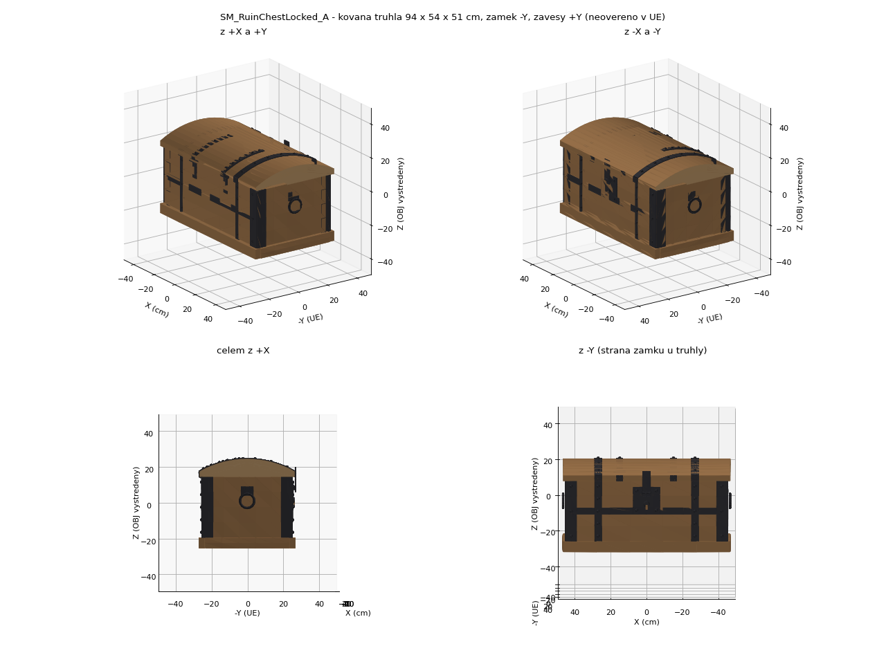

---
# orchestrace
type: asset
asset_status: imported
requested_by: legacy
requested:
owner: Crafter
priority: medium
depends_on: []
superseded_by:
updated: 2026-11-24
aliases: ["SM_RuinChestLocked"]
# hra
asset_kind: mesh
asset_category: props
used_by: ["[[Guesthouse]]"]
envelope: [95, 55, 51]
stand_in: none
asset_source: tools/meshes/mesh_props.py:chest_locked
ue_path: /Game/Skvt/Lapikus/Ruin/Props/SM_RuinChestLocked_A
variants: []
---
# SM_RuinChestLocked_A

## Účel a použití
Kovaná truhla na cennosti hosta se zámkem (graybox `GH_CHEST`), v nohách postele, zámkem k severu; `shape: chest_locked`, `finish: oil`.

Osy: **zámek a závěra −Y**, pásové závěsy +Y, držadla s kruhy ±X, delší strana X; pivot ve středu bounding boxu. Společná pravidla: [[Konvence_assetu]].

## Požadavek

## Na míru

## Z kódu
<!-- hestia:generated:start -->

<!-- hestia:asset_code -->
- Rozměr (skutečný): 94.2 × 54.2 × 50.7 cm; `envelope` 95 × 55 × 51 cm: vejde se
- Varianty: `SM_RuinChestLocked_A`
- Sloty: ['wood', 'endgrain', 'ironclean']
- Výchozí materiál: `wood`
- Verze: 1 (prefix `SM_RuinChestLocked`, `RuinStoneVersion`)
- Globální verze: `MESH_AXES` 10
- `ue_path` (odvozená): `/Game/Skvt/Lapikus/Ruin/Props/SM_RuinChestLocked_A.SM_RuinChestLocked_A`
- `.uasset` na disku: ano
- Zdroj: `PrototypeDesigns/Lapikus/zrlib/config.py:274`
- Data: `PrototypeDesigns/Lapikus/06_furnishing/furnishing.json` ([[Lapikus]])

<!-- hestia:generated:end -->

## Stav v UE
<!-- hestia:generated:start -->

<!-- hestia:asset_ue -->
Čtení z UE: `Maintenance/reports/ue_assets.json` · etapa 1 (skript v editoru) (datum čtení u každého assetu)

- `SM_RuinChestLocked_A` (čteno 2026-11-23): v UE ano (`/Game/Skvt/Lapikus/Ruin/Props/SM_RuinChestLocked_A.SM_RuinChestLocked_A`) · `RuinStoneVersion` 1 (kód 1) · `RuinMeshAxes` 10 (`MESH_AXES` 10) · current

<!-- hestia:generated:end -->

## Vizuálně ověřeno
<!-- verified (jen GameDesigner): kdo, kdy (RRRR-MM-DD), verze -->

## Poznámky
- Konstrukce: hoblovaná prkna na soklu, klenuté víko, černé kování bez rzi (`IronClean`): rohovníky, 2 svislé pásy přes korpus a víko, vodorovný pás, nýty, zámková deska s klíčovou dírkou.
- Převedeno z [[Katalog_props]] a [[CHECKLIST_assets_navrhy]] kap. 6.8 při zavedení karet (P19, Steward, 2026-11-23); stav podle kódu a `.uasset`, potvrdí Crafter. `requested_by: legacy` (vyrobeno před zavedením karet, CR-036).
