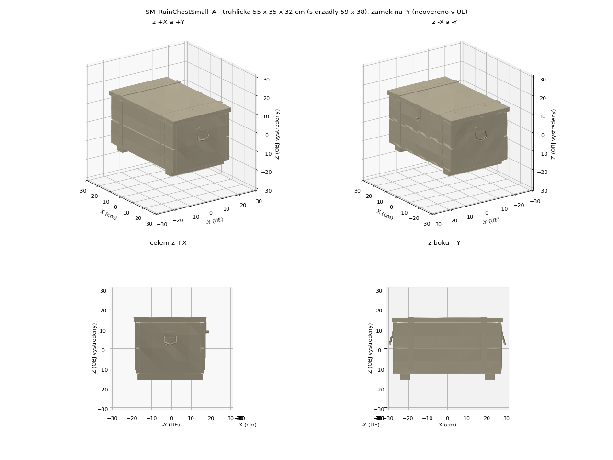

---
# orchestrace
type: asset
asset_status: imported
requested_by: Furnisher
requested: 2026-11-21
owner: Crafter
priority: medium
depends_on: []
superseded_by:
updated: 2026-11-23
aliases: ["SM_RuinChestSmall"]
# hra
asset_kind: mesh
asset_category: props
used_by: ["[[Nadvori_Stan]]"]
envelope: [60, 38, 32]
stand_in: none
asset_source: tools/meshes/mesh_props.py:chest_small
ue_path: /Game/Skvt/Lapikus/Ruin/Props/SM_RuinChestSmall_A
variants: []
---
# SM_RuinChestSmall_A

## Účel a použití
Truhlička ve stanu (korpus 55 × 35 × 32 cm, s držadly 59,3 cm), 2 železné pásy; `shape: chest_small`, `finish: raw`. Leží vedle lůžka u hlavy, zámkem do uličky.

Osy: **zámek (oko na zámek) −Y**, držadla ±X; pivot ve středu bounding boxu. Společná pravidla: [[Konvence_assetu]].

## Požadavek

## Na míru

## Z kódu
Ručně do etapy B (P20, `asset_sources.yaml`), stav kódu 2026-11-23:
- rozměr (bounding box OBJ `meshes/props/`): 59,3 × 38,0 × 31,7 cm
- varianty v UE: `SM_RuinChestSmall_A`
- sloty: `wood`, `iron`; výchozí materiál dílce `wood`
- verze: `STONE_MESH_VERSION["SM_RuinChestSmall"]` = 1; `MESH_AXES` = 10

## Stav v UE
Ručně do etapy C (`ue_query --assets`): `.uasset` je v `Content/Skvt/Lapikus/Ruin/Props/` (v gitu, 2026-11-23); verze v UE a vzhled neověřeny.

## Vizuálně ověřeno
<!-- verified (jen GameDesigner): kdo, kdy (RRRR-MM-DD), verze -->

## Poznámky
- Železo s patinou rzi (`Iron`).
- Převedeno z [[Katalog_props]] a [[CHECKLIST_assets_navrhy]] kap. 6.5 při zavedení karet (P19, Steward, 2026-11-23); stav podle kódu a `.uasset`, potvrdí Crafter. `requested_by` a `requested` doplněny podle role, která asset používá, a data v checklistu.
