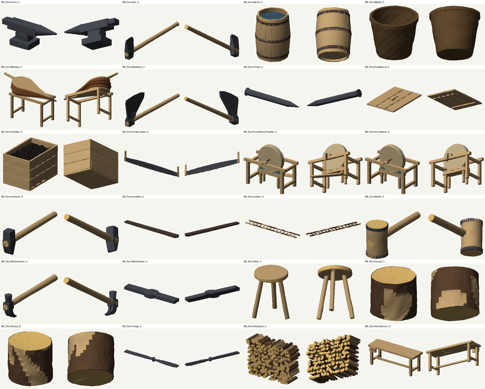

---
# orchestrace
type: asset
asset_status: imported
requested_by: Furnisher
requested: 2026-11-14
owner: Crafter
priority: medium
depends_on: []
superseded_by:
updated: 2026-11-23
aliases: ["SM_RuinHammer"]
# hra
asset_kind: mesh
asset_category: props
used_by: ["[[Palac_Kovarna_Vybaveni]]"]
envelope: [5, 37, 11]
stand_in: none
asset_source: tools/meshes/mesh_props.py:hammer
ue_path: /Game/Skvt/Lapikus/Ruin/Props/SM_RuinHammer_A
variants: []
---
# SM_RuinHammer_A

## Účel a použití
Kovářské kladivo (nářadí na liště).

Osy: nejdelší rozměr podél Y (podle rozměru meshe); pivot ve středu bounding boxu. Společná pravidla: [[Konvence_assetu]].

## Požadavek

## Na míru

## Z kódu
<!-- hestia:generated:start -->

<!-- hestia:asset_code -->
- Rozměr (skutečný): 4.3 × 36.4 × 11 cm; `envelope` 5 × 37 × 11 cm: vejde se
- Varianty: `SM_RuinHammer_A`
- Sloty: ['wood', 'endgrain', 'ironclean']
- Výchozí materiál: `wood`
- Verze: 5 (prefix `SM_RuinHammer`, `RuinStoneVersion`)
- Globální verze: `MESH_AXES` 10
- `ue_path` (odvozená): `/Game/Skvt/Lapikus/Ruin/Props/SM_RuinHammer_A.SM_RuinHammer_A`
- `.uasset` na disku: ano
- Zdroj: `PrototypeDesigns/Lapikus/zrlib/config.py:245`
- Data: `PrototypeDesigns/Lapikus/06_furnishing/furnishing.json` ([[Lapikus]])

<!-- hestia:generated:end -->

## Stav v UE
Ručně do etapy C (`ue_query --assets`): `.uasset` je v `Content/Skvt/Lapikus/Ruin/Props/` (v gitu, 2026-11-23); verze v UE a vzhled neověřeny.

## Vizuálně ověřeno
<!-- verified (jen GameDesigner): kdo, kdy (RRRR-MM-DD), verze -->

## Poznámky
- Převedeno z [[CHECKLIST_assets_navrhy]] kap. 6.1 při zavedení karet (P19, Steward, 2026-11-23); stav podle kódu a `.uasset`, potvrdí Crafter. `requested_by` a `requested` doplněny podle role, která asset používá, a data v checklistu.
