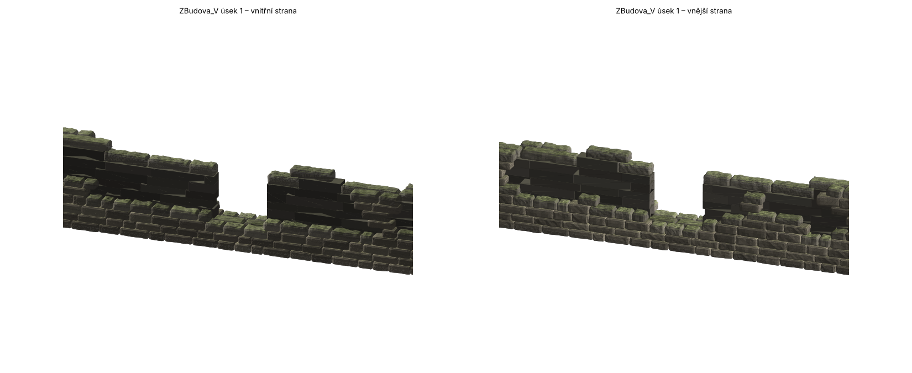

---
# orchestrace
type: asset
asset_status: imported
requested_by: Builder
requested: 2026-11-14
owner: Builder
priority: medium
depends_on: []
superseded_by:
updated: 2026-11-23
aliases: ["SM_RuinStone_W_R12"]
# hra
asset_kind: mesh
asset_category: stone
used_by: ["[[Lapikus]]"]
envelope: [102, 45, 30]
stand_in: none
asset_source: tools/meshes/mesh_stone.py:make_stone
ue_path: /Game/Skvt/Lapikus/Ruin/Stones/SM_RuinStone_W_R12_A
variants: [SM_RuinStone_W_R12_B, SM_RuinStone_W_R12_C, SM_RuinStone_W_R18_A, SM_RuinStone_W_R18_B, SM_RuinStone_W_R18_C, SM_RuinStone_W_R26_A, SM_RuinStone_W_R26_B, SM_RuinStone_W_R26_C, SM_RuinStone_W_R34_A, SM_RuinStone_W_R34_B, SM_RuinStone_W_R34_C]
---
# SM_RuinStone_W_R12_A

## Účel a použití
Zvětralý kámen koruny zdi (`CROWN_WEATHER`): odkryté horní kameny, zaoblené a otlučené hlavně shora, materiál `MI_RuinCrown`. Varianty podle poměru délka/výška (R12 = 1,2 až R34 = 3,4, `STONE_RATIOS`) a tvaru (A/B/C); jmenovitý kámen výška 30 × hloubka 45 cm (`STONE_NOMINAL`), délka = výška × poměr, ve zdi se natahuje na blok.

Osy: délka podél X, hloubka zdi Y, výška Z; pivot ve středu bounding boxu. Společná pravidla: [[Konvence_assetu]].

## Požadavek

## Na míru

## Z kódu
Ručně do etapy B (P20, `asset_sources.yaml`), stav kódu 2026-11-23:
- rozměr (bounding box OBJ `meshes/stone/`): 36,0 × 45,0 × 30,0 cm (SM_RuinStone_W_R12_A, SM_RuinStone_W_R12_B, SM_RuinStone_W_R12_C); 54,0 × 45,0 × 30,0 cm (SM_RuinStone_W_R18_A, SM_RuinStone_W_R18_B, SM_RuinStone_W_R18_C); 78,0 × 45,0 × 30,0 cm (SM_RuinStone_W_R26_A, SM_RuinStone_W_R26_B, SM_RuinStone_W_R26_C); 102,0 × 45,0 × 30,0 cm (SM_RuinStone_W_R34_A, SM_RuinStone_W_R34_B, SM_RuinStone_W_R34_C)
- varianty v UE: `SM_RuinStone_W_R12_A`, `SM_RuinStone_W_R12_B`, `SM_RuinStone_W_R12_C`, `SM_RuinStone_W_R18_A`, `SM_RuinStone_W_R18_B`, `SM_RuinStone_W_R18_C`, `SM_RuinStone_W_R26_A`, `SM_RuinStone_W_R26_B`, `SM_RuinStone_W_R26_C`, `SM_RuinStone_W_R34_A`, `SM_RuinStone_W_R34_B`, `SM_RuinStone_W_R34_C`
- verze: `STONE_MESH_VERSION["SM_RuinStone_W_"]` = 2; `MESH_AXES` = 10

## Stav v UE
Ručně do etapy C (`ue_query --assets`): `.uasset` všech 12 variant v `Content/Skvt/Lapikus/Ruin/Stones/` (v gitu, 2026-11-23); verze v UE a vzhled neověřeny.

## Vizuálně ověřeno
<!-- verified (jen GameDesigner): kdo, kdy (RRRR-MM-DD), verze -->

## Poznámky
- Převedeno z [[CHECKLIST_assets_navrhy]] kap. 1 při zavedení karet (P19, Steward, 2026-11-23); stav podle kódu a `.uasset`, potvrdí Builder. `requested_by` a `requested` doplněny podle role, která asset používá, a data v checklistu.
