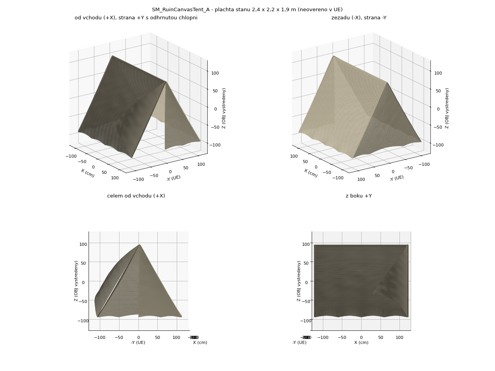

---
# orchestrace
type: asset
asset_status: imported
requested_by: legacy
requested:
owner: Crafter
priority: medium
depends_on: []
superseded_by:
updated: 2026-11-24
aliases: ["SM_RuinCanvasTent"]
# hra
asset_kind: mesh
asset_category: textile
used_by: ["[[Nadvori_Stan]]"]
envelope: [246, 228, 190]
stand_in: none
asset_source: tools/meshes/mesh_textile.py:canvas_tent
ue_path: /Game/Skvt/Lapikus/Ruin/Textile/SM_RuinCanvasTent_A
variants: []
---
# SM_RuinCanvasTent_A

## Účel a použití
Plachta stanu do A na nádvoří: díl přes hřeben, dva štíty, odhrnutá chlopeň; půdorys 2,4 × 2,2 m, hřeben 1,9 m, boky asi 60°. Data: `shape: canvas_tent`, `cat: canvas` (`MI_RuinCanvas`, oboustranný `M_RuinCloth`).

Osy: X podél hřebene, **+X = štít se vchodem**, +Y = strana odhrnuté chlopně, −Y zavřená chlopeň, zadní štít (−X) zavřený; pivot ve středu bounding boxu, stavba mesh posadí podle `center` v `.json`. Společná pravidla: [[Konvence_assetu]].

## Požadavek

## Na míru
`meshes/textile/SM_RuinCanvasTent_A.json`: `center` (střed bounding boxu v osách stanu, počátek na zemi pod středem hřebene), `size`, `ridge` (vrch 190 cm, Ø 6, x −130…130), `poles` (stojky Ø 7 v x = ±120), `pegs` (13 kolíků, lem k zemi), `door`. Stavba posadí mesh podle `center` (vzor `zr_stavby/pristresek.py`, `LIB_SHAPE_OF`). Parametry generátoru `TENT`: `L`, `W`, `H`, `sag` (prohnutí boků), `bulge` (vydutí štítů), `hem` (zvednutí lemu mezi kolíky), `pegs_x`, `pegs_back`, `pegs_door`, `flap` (úhel odhrnuté chlopně).

## Z kódu
<!-- hestia:generated:start -->

<!-- hestia:asset_code -->
- Rozměr (skutečný): 246 × 227.7 × 189.6 cm; `envelope` 246 × 228 × 190 cm: vejde se
- Varianty: `SM_RuinCanvasTent_A`
- Sloty: ['canvas']
- Výchozí materiál: `canvas`
- Verze: 1 (prefix `SM_RuinCanvasTent`, `RuinStoneVersion`)
- Globální verze: `MESH_AXES` 10
- `ue_path` (odvozená): `/Game/Skvt/Lapikus/Ruin/Textile/SM_RuinCanvasTent_A.SM_RuinCanvasTent_A`
- `.uasset` na disku: ano
- Zdroj: `PrototypeDesigns/Lapikus/zrlib/config.py:237`
- Data: `PrototypeDesigns/Lapikus/05_constructions/constructions.json` ([[Lapikus]])

<!-- hestia:generated:end -->

## Stav v UE
<!-- hestia:generated:start -->

<!-- hestia:asset_ue -->
Čtení z UE: `Maintenance/reports/ue_assets.json` · etapa 1 (skript v editoru) (datum čtení u každého assetu)

- `SM_RuinCanvasTent_A` (čteno 2026-11-23): v UE ano (`/Game/Skvt/Lapikus/Ruin/Textile/SM_RuinCanvasTent_A.SM_RuinCanvasTent_A`) · `RuinStoneVersion` 1 (kód 1) · `RuinMeshAxes` 10 (`MESH_AXES` 10) · current

<!-- hestia:generated:end -->

## Vizuálně ověřeno
<!-- verified (jen GameDesigner): kdo, kdy (RRRR-MM-DD), verze -->

## Poznámky
- Vchod jen shrbeně (polovina štítu, při 0,7 m šířky asi 0,7 m výšky), schválil Jirka 22. 11. 2026. Pro chlopeň na druhé straně stačí mesh zrcadlit (scale Y −1).
- Stojky, hřeben, kolíky, šňůry a stříšku skládá Builder z hotových meshí (typy `tent`, `bark_roof`).
- Převedeno z [[Katalog_props]] a [[CHECKLIST_assets_navrhy]] kap. 6.5 při zavedení karet (P19, Steward, 2026-11-23); stav podle kódu a `.uasset`, potvrdí Crafter. `requested_by: legacy` (vyrobeno před zavedením karet, CR-036).
