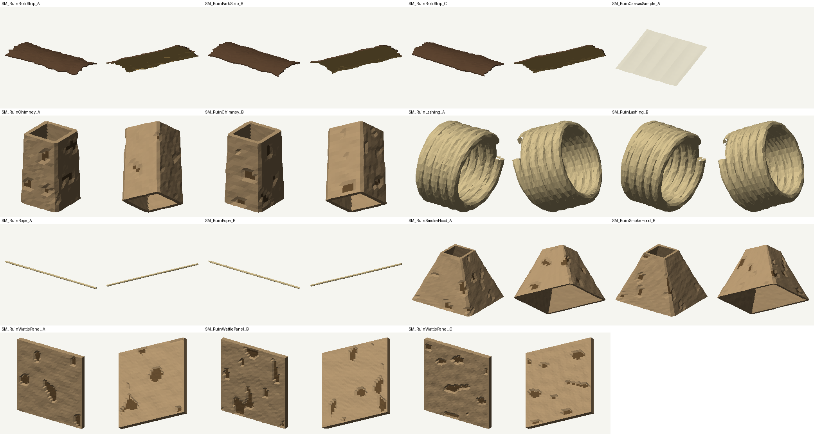

---
# orchestrace
type: asset
asset_status: imported
requested_by: legacy
requested:
owner: Crafter
priority: medium
depends_on: []
superseded_by:
updated: 2026-11-24
aliases: ["SM_RuinLashing"]
# hra
asset_kind: mesh
asset_category: textile
used_by: ["[[Vez_Pristresek]]", "[[Brana_Straz]]", "[[Nadvori_Stan]]"]
envelope: [7, 11, 11]
stand_in: none
asset_source: tools/meshes/mesh_textile.py:make_lashing
ue_path: /Game/Skvt/Lapikus/Ruin/Textile/SM_RuinLashing_A
variants: [SM_RuinLashing_B]
---
# SM_RuinLashing_A

## Účel a použití
Ovázání na křížení tyčí: závity lana kolem tyče Ø 8 cm, škáluje se s tyčí (krokve, ráhna, vidlice).

Osy: osa tyče X; pivot ve středu bounding boxu. Společná pravidla: [[Konvence_assetu]].

## Požadavek

## Na míru

## Z kódu
<!-- hestia:generated:start -->

<!-- hestia:asset_code -->
- Rozměr (skutečný): 7 × 10.5 × 10.5 cm; `envelope` 7 × 11 × 11 cm: vejde se
- Varianty: `SM_RuinLashing_A`, `SM_RuinLashing_B`
- Sloty: ['rope']
- Výchozí materiál: `rope`
- Verze: 1 (prefix `SM_RuinLashing`, `RuinStoneVersion`)
- Globální verze: `MESH_AXES` 10
- `ue_path` (odvozená): `/Game/Skvt/Lapikus/Ruin/Textile/SM_RuinLashing_A.SM_RuinLashing_A`
- `.uasset` na disku: ano
- Zdroj: `PrototypeDesigns/Lapikus/zrlib/config.py:232`
- Data: bez výskytu

<!-- hestia:generated:end -->

## Stav v UE
<!-- hestia:generated:start -->

<!-- hestia:asset_ue -->
Čtení z UE: `Maintenance/reports/ue_assets.json` · etapa 1 (skript v editoru) (datum čtení u každého assetu)

- `SM_RuinLashing_A` (čteno 2026-11-23): v UE ano (`/Game/Skvt/Lapikus/Ruin/Textile/SM_RuinLashing_A.SM_RuinLashing_A`) · `RuinStoneVersion` 1 (kód 1) · `RuinMeshAxes` 10 (`MESH_AXES` 10) · current
- `SM_RuinLashing_B` (čteno 2026-11-23): v UE ano (`/Game/Skvt/Lapikus/Ruin/Textile/SM_RuinLashing_B.SM_RuinLashing_B`) · `RuinStoneVersion` 1 (kód 1) · `RuinMeshAxes` 10 (`MESH_AXES` 10) · current

<!-- hestia:generated:end -->

## Vizuálně ověřeno
<!-- verified (jen GameDesigner): kdo, kdy (RRRR-MM-DD), verze -->

## Poznámky
- Převedeno z [[CHECKLIST_assets_navrhy]] kap. 4 při zavedení karet (P19, Steward, 2026-11-23); stav podle kódu a `.uasset`, potvrdí Crafter. `requested_by: legacy` (vyrobeno před zavedením karet, CR-036).
