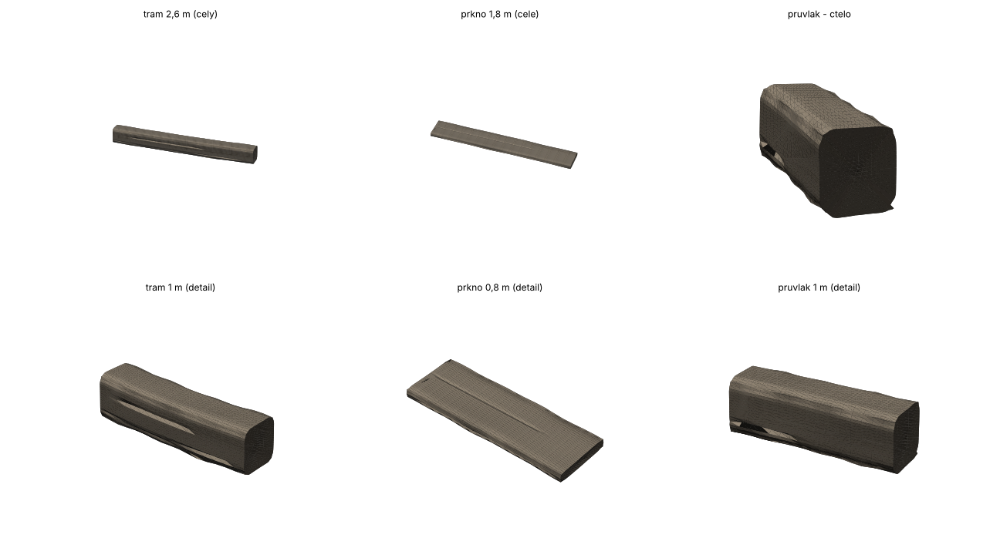

---
# orchestrace
type: asset
asset_status: imported
requested_by: legacy
requested:
owner: Builder
priority: medium
depends_on: []
superseded_by:
updated: 2026-11-24
aliases: ["SM_RuinPlank"]
# hra
asset_kind: mesh
asset_category: wood
used_by: ["[[Palac_Kovarna]]", "[[Palac_Obydli]]", "[[Vez_Pristresek]]", "[[Brana_Straz]]", "[[Guesthouse]]", "[[Brana]]"]
envelope: [100, 25, 5]
stand_in: none
asset_source: tools/meshes/mesh_wood.py:make_timber
ue_path: /Game/Skvt/Lapikus/Ruin/Wood/SM_RuinPlank_A
variants: [SM_RuinPlank_B, SM_RuinPlank_C]
---
# SM_RuinPlank_A

## Účel a použití
Prkno: krytina, podlahy, lišty, lemování, prkenné štíty.

Osy: délka podél X (nominál 100 cm), šířka Y, tloušťka Z; pivot ve středu bounding boxu. Společná pravidla: [[Konvence_assetu]].

## Požadavek

## Na míru

## Z kódu
Ručně (doplněk k bloku: zdroj bez rozměru, rozměr z OBJ k 2026-11-23):
- rozměr (bounding box OBJ `meshes/wood/`): 100,0 × 25,0 × 5,0 cm
<!-- hestia:generated:start -->

<!-- hestia:asset_code -->
- Rozměr (skutečný): 100 × 25 × 5 cm; `envelope` 100 × 25 × 5 cm: vejde se
- Varianty: `SM_RuinPlank_A`, `SM_RuinPlank_B`, `SM_RuinPlank_C`
- Verze: 2 (prefix `SM_RuinPlank_`, `RuinStoneVersion`)
- Globální verze: `MESH_AXES` 10
- `ue_path` (odvozená): `/Game/Skvt/Lapikus/Ruin/Wood/SM_RuinPlank_A.SM_RuinPlank_A`
- `.uasset` na disku: ano
- Zdroj: `PrototypeDesigns/Lapikus/zrlib/config.py:188`
- Data: bez výskytu

<!-- hestia:generated:end -->

## Stav v UE
Ručně do etapy C (`ue_query --assets`): `.uasset` všech 3 variant v `Content/Skvt/Lapikus/Ruin/Wood/` (v gitu, 2026-11-23); verze v UE a vzhled neověřeny.

## Vizuálně ověřeno
<!-- verified (jen GameDesigner): kdo, kdy (RRRR-MM-DD), verze -->

## Poznámky
- Převedeno z [[CHECKLIST_assets_navrhy]] kap. 1 při zavedení karet (P19, Steward, 2026-11-23); stav podle kódu a `.uasset`, potvrdí Builder. `requested_by: legacy` (vyrobeno před zavedením karet, CR-036).
