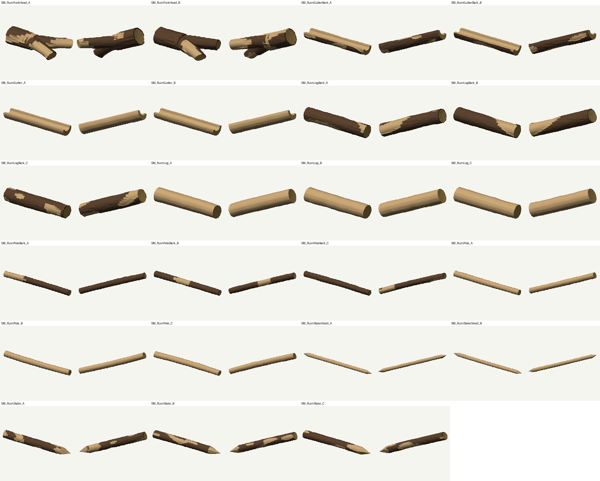

---
# orchestrace
type: asset
asset_status: imported
requested_by: Builder
requested: 2026-11-14
owner: Builder
priority: medium
depends_on: []
superseded_by:
updated: 2026-11-23
aliases: ["SM_RuinPole"]
# hra
asset_kind: mesh
asset_category: wood
used_by: ["[[Palac_Kovarna]]", "[[Brana_Straz]]", "[[Nadvori_Stan]]"]
envelope: [100, 8, 8]
stand_in: none
asset_source: tools/meshes/mesh_log.py:make_pole
ue_path: /Game/Skvt/Lapikus/Ruin/Wood/SM_RuinPole_A
variants: [SM_RuinPole_B, SM_RuinPole_C]
---
# SM_RuinPole_A

## Účel a použití
Loupaná tenká tyč s výraznějším prohnutím (zábradlí, páka měchů, kolíky).

Osy: délka podél X (nominál 100,0 cm, délka a průměr přes scale); pivot ve středu bounding boxu. Společná pravidla: [[Konvence_assetu]].

## Požadavek

## Na míru

## Z kódu
Ručně do etapy B (P20, `asset_sources.yaml`), stav kódu 2026-11-23:
- rozměr (bounding box OBJ `meshes/wood/`): 100,0 × 8,0 × 8,0 cm
- varianty v UE: `SM_RuinPole_A`, `SM_RuinPole_B`, `SM_RuinPole_C`
- sloty: `wood`, `endgrain`
- verze: `STONE_MESH_VERSION["SM_RuinPole"]` = 1; `MESH_AXES` = 10

## Stav v UE
Ručně do etapy C (`ue_query --assets`): `.uasset` všech 3 variant v `Content/Skvt/Lapikus/Ruin/Wood/` (v gitu, 2026-11-23); verze v UE a vzhled neověřeny.

## Vizuálně ověřeno
<!-- verified (jen GameDesigner): kdo, kdy (RRRR-MM-DD), verze -->

## Poznámky
- Převedeno z [[CHECKLIST_assets_navrhy]] kap. 2.2 při zavedení karet (P19, Steward, 2026-11-23); stav podle kódu a `.uasset`, potvrdí Builder. `requested_by` a `requested` doplněny podle role, která asset používá, a data v checklistu.
