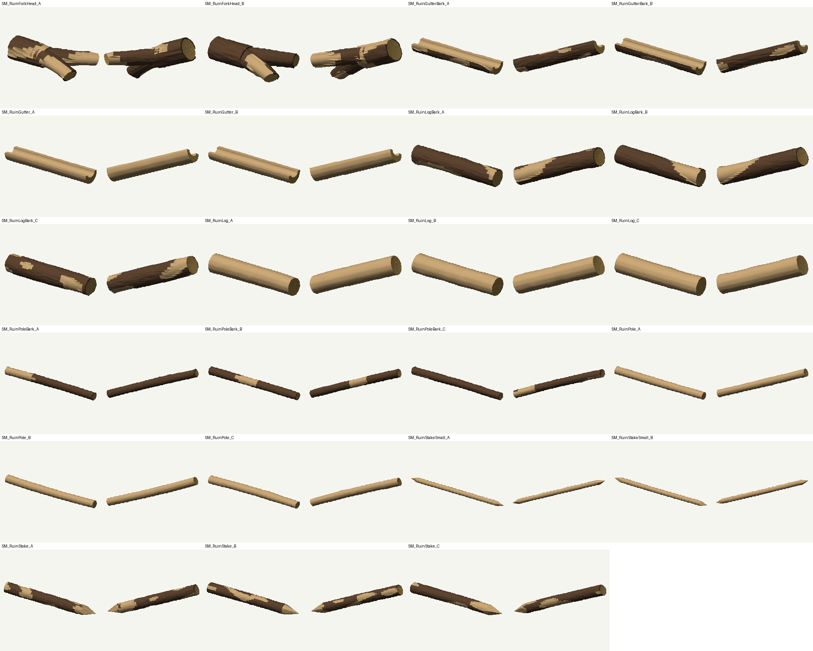

---
# orchestrace
type: asset
asset_status: imported
requested_by: Builder
requested: 2026-11-14
owner: Builder
priority: medium
depends_on: []
superseded_by:
updated: 2026-11-23
aliases: ["SM_RuinStakeSmall"]
# hra
asset_kind: mesh
asset_category: wood
used_by: ["[[Nadvori_Stan]]", "[[Brana]]"]
envelope: [160, 7, 7]
stand_in: none
asset_source: tools/meshes/mesh_log.py:make_stake_small
ue_path: /Game/Skvt/Lapikus/Ruin/Wood/SM_RuinStakeSmall_A
variants: [SM_RuinStakeSmall_B]
---
# SM_RuinStakeSmall_A

## Účel a použití
Loupaný kůl zašpičatělý na obou koncích (ramena jezdce, kolíky stanu).

Osy: délka podél X (nominál 160,0 cm, délka a průměr přes scale); špičky na obou koncích X; pivot ve středu bounding boxu. Společná pravidla: [[Konvence_assetu]].

## Požadavek

## Na míru

## Z kódu
Ručně do etapy B (P20, `asset_sources.yaml`), stav kódu 2026-11-23:
- rozměr (bounding box OBJ `meshes/wood/`): 160,0 × 7,0 × 7,0 cm
- varianty v UE: `SM_RuinStakeSmall_A`, `SM_RuinStakeSmall_B`
- sloty: `wood`, `endgrain`
- verze: `STONE_MESH_VERSION["SM_RuinStake"]` = 1; `MESH_AXES` = 10

## Stav v UE
Ručně do etapy C (`ue_query --assets`): `.uasset` všech 2 variant v `Content/Skvt/Lapikus/Ruin/Wood/` (v gitu, 2026-11-23); verze v UE a vzhled neověřeny.

## Vizuálně ověřeno
<!-- verified (jen GameDesigner): kdo, kdy (RRRR-MM-DD), verze -->

## Poznámky
- Převedeno z [[CHECKLIST_assets_navrhy]] kap. 2.2 při zavedení karet (P19, Steward, 2026-11-23); stav podle kódu a `.uasset`, potvrdí Builder. `requested_by` a `requested` doplněny podle role, která asset používá, a data v checklistu.
