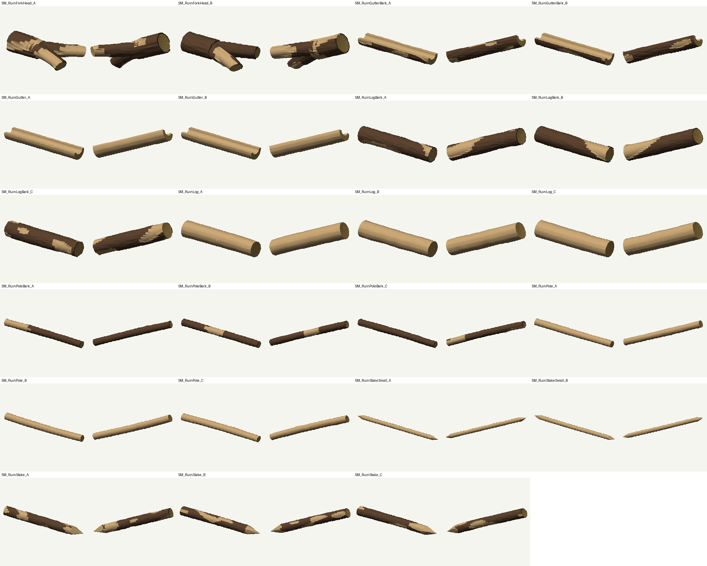

---
# orchestrace
type: asset
asset_status: imported
requested_by: legacy
requested:
owner: Builder
priority: medium
depends_on: []
superseded_by:
updated: 2026-11-24
aliases: ["SM_RuinStake"]
# hra
asset_kind: mesh
asset_category: wood
used_by: ["[[Brana_Straz]]"]
envelope: [200, 20, 20]
stand_in: none
asset_source: tools/meshes/mesh_log.py:make_stake
ue_path: /Game/Skvt/Lapikus/Ruin/Wood/SM_RuinStake_A
variants: [SM_RuinStake_B, SM_RuinStake_C]
---
# SM_RuinStake_A

## Účel a použití
Kůl s kůrou, nahoře holá zaseknutá špička na +X (kryty brány, palisáda).

Osy: délka podél X (nominál 200,0 cm, délka a průměr přes scale); špička na +X; pivot ve středu bounding boxu. Společná pravidla: [[Konvence_assetu]].

## Požadavek

## Na míru

## Z kódu
<!-- hestia:generated:start -->

<!-- hestia:asset_code -->
- Rozměr (skutečný): 200 × 20 × 20 cm; `envelope` 200 × 20 × 20 cm: vejde se
- Varianty: `SM_RuinStake_A`, `SM_RuinStake_B`, `SM_RuinStake_C`
- Sloty: ['wood', 'endgrain', 'bark']
- Verze: 1 (prefix `SM_RuinStake`, `RuinStoneVersion`)
- Globální verze: `MESH_AXES` 10
- `ue_path` (odvozená): `/Game/Skvt/Lapikus/Ruin/Wood/SM_RuinStake_A.SM_RuinStake_A`
- `.uasset` na disku: ano
- Zdroj: `PrototypeDesigns/Lapikus/zrlib/config.py:199`
- Data: bez výskytu

<!-- hestia:generated:end -->

## Stav v UE
Ručně do etapy C (`ue_query --assets`): `.uasset` všech 3 variant v `Content/Skvt/Lapikus/Ruin/Wood/` (v gitu, 2026-11-23); verze v UE a vzhled neověřeny.

## Vizuálně ověřeno
<!-- verified (jen GameDesigner): kdo, kdy (RRRR-MM-DD), verze -->

## Poznámky
- Převedeno z [[CHECKLIST_assets_navrhy]] kap. 2.2 při zavedení karet (P19, Steward, 2026-11-23); stav podle kódu a `.uasset`, potvrdí Builder. `requested_by: legacy` (vyrobeno před zavedením karet, CR-036).
