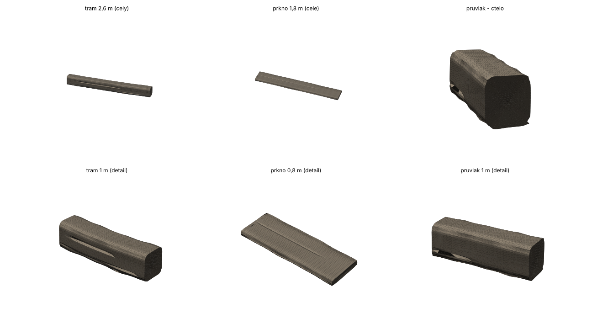

---
# orchestrace
type: asset
asset_status: imported
requested_by: Builder
requested: 2026-11-14
owner: Builder
priority: medium
depends_on: []
superseded_by:
updated: 2026-11-23
aliases: ["SM_RuinTimber"]
# hra
asset_kind: mesh
asset_category: wood
used_by: ["[[Palac_Kovarna]]", "[[Palac_Obydli]]", "[[Vez_Pristresek]]", "[[Brana_Straz]]", "[[Guesthouse]]"]
envelope: [100, 25, 25]
stand_in: none
asset_source: tools/meshes/mesh_wood.py:make_timber
ue_path: /Game/Skvt/Lapikus/Ruin/Wood/SM_RuinTimber_A
variants: [SM_RuinTimber_B, SM_RuinTimber_C]
---
# SM_RuinTimber_A

## Účel a použití
Hraněný trám (zašlé dřevo): sloupy, pozednice, vaznice, krokve, trámky stropu.

Osy: délka podél X (nominál 100 cm, natahuje se přes scale), průřez Y × Z; pivot ve středu bounding boxu. Společná pravidla: [[Konvence_assetu]].

## Požadavek

## Na míru

## Z kódu
Ručně: klíč není v `LIB_MESHES` a manifest `asset_sources.yaml` ho nepokrývá (`ROUND_MESHES`, `WOOD_NOMINAL`, kameny v `mesh_stone.py`); stav kódu 2026-11-23:
- rozměr (bounding box OBJ `meshes/wood/`): 100,0 × 25,0 × 25,0 cm
- varianty v UE: `SM_RuinTimber_A`, `SM_RuinTimber_B`, `SM_RuinTimber_C`
- verze: `STONE_MESH_VERSION["SM_RuinTimber_"]` = 2; `MESH_AXES` = 10
<!-- hestia:generated:start -->

<!-- hestia:asset_code -->
_v kódu nenalezeno (`asset_sources.yaml`); technické údaje doplní kód, ne karta._

<!-- hestia:generated:end -->

## Stav v UE
Ručně do etapy C (`ue_query --assets`): `.uasset` všech 3 variant v `Content/Skvt/Lapikus/Ruin/Wood/` (v gitu, 2026-11-23); verze v UE a vzhled neověřeny.

## Vizuálně ověřeno
<!-- verified (jen GameDesigner): kdo, kdy (RRRR-MM-DD), verze -->

## Poznámky
- Převedeno z [[CHECKLIST_assets_navrhy]] kap. 1 při zavedení karet (P19, Steward, 2026-11-23); stav podle kódu a `.uasset`, potvrdí Builder. `requested_by` a `requested` doplněny podle role, která asset používá, a data v checklistu.
