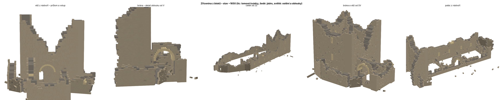

---
# orchestrace
type: step
validity: valid
aliases: [README_bloky]
step_kind: build
updated: 2026-11-23
# hra
build_step: 03_ruin
domains: [structures]
entity: "[[Lapikus]]"
---
# 03 Ruin – zřícenina z kamenných bloků (stav ~1650) – návod pro UE 5.8

## Souhrn
Generátor zříceniny z kamenných bloků (~18 500 kusů) pro UE 5.8: jednorázová příprava (Blueprint, meshe, materiály), generování celé zříceniny nebo jejích částí (`casti\<Cast>.py`), stáří a sloučení. Části dokumentu:
- [[03_ruin_upravy]]: úpravy v datech (`edits`) a bourací objemy, ruční posun kamenů, oddělení části zdi (kap. 4, 5);
- [[03_ruin_generator]]: skladba zdi a struktura kódu (kap. 7);
- [[Meshe]]: meshe kamenů a dřeva a materiály (kap. 1.1, 1.2), sdílené s 05 a 06.
- Stav postavené zříceniny: [[Zricenina_03_ruin_stav]].

## Účel kroku
Nová metoda generování: zřícenina se skládá **z jednotlivých kamenných bloků** (~18 500 kusů) místo svislých sloupců.

- Okna, průchody a výšky zdí upravíš **bouracími objemy přímo v levelu** (Trigger Box s tagem, [[03_ruin_upravy]] kap. 5) nebo v datech ([[03_ruin_upravy]] kap. 4) a přegeneruješ.
- Jednotlivé kameny můžeš rozložit na samostatné actory, ručně posunout a smazat. Změny se pamatují i po přegenerování.



**Nastavení vzhledu** (materiály `MAT_*`, `MAT_LOOK`, `MAT_TOP`, zaoblené kameny `USE_STONE_MESHES`, `STONE_*`, dřevo `WOOD_*`, fyzika `STONE_PHYSICS`, tagy) je od 11/2026 v **`zrlib\config.py`** v kořeni repozitáře a platí pro 03 i 05. Nahoře v `build_ruin_blocks.py` zůstává jen nastavení běhu (`LAYOUT_PATH`, `AGE`, `OVERRIDE`, `TERRAIN_FROM_LEVEL`, `ONLY_WALLS`, `CAST`, `CASTI`, `MODE`). Struktura kódu a skladba zdi: [[03_ruin_generator]].

Původní sloupcový generátor (`03_ruin\build`) zůstává beze změny. Obě metody používají tag `Zricenina_Ruin`, takže generují do stejných složek a navzájem se přepisují.

---

## Spouštění
### 1. Příprava (jednorázově)

1. Zkopíruj obsah složky `03_ruin\blocks` kamkoli. Soubory `build_ruin_blocks.py`, `ruin_layout.json` a `manual_edits.json` musí zůstat **vedle sebe**.
2. **Záložní Blueprint (doporučeno vytvořit hned).** Skript se nejdřív pokusí přidat komponentu Instanced Static Mesh sám. Kdyby to v UE 5.8 nešlo, použije tento Blueprint:
   1. Content Browser → `Skvt/Lapikus/Ruin` → pravé tlačítko → **Blueprint Class → Actor** → `BP_RuinBlocks`.
   2. Otevři ho a v panelu Components dej **Add → Instanced Static Mesh**. Komponentu nech, jak je, nic nenastavuj.
   3. **Compile** a **Save**.
3. **Meshe kamenů a dřeva:** složka `meshes` (OBJ v podsložkách `stone` a `wood`) musí ležet v kořeni `Lapikus` vedle `zrlib`. OBJ ani textury nejsou v gitu, po naklonování je vygeneruj: `python tools/meshes/gen_meshes.py` a `python tools/textures/gen_textures.py`. Při prvním spuštění je skript sám naimportuje (kameny do `/Game/Skvt/Lapikus/Ruin/Stones`, dřevo do `/Ruin/Wood`), zapne Nanite a přidá krabicovou kolizi. Podrobnosti a ruční import v [[Meshe]] kap. 1.1.
4. **Materiály:** skript při prvním spuštění vytvoří `M_RuinStone` a instance `MI_RuinFace`, `MI_RuinCore`, `MI_RuinFrame` v `/Game/Skvt/Lapikus/Ruin/Materials` (textury ze StarterContent). Další spuštění je už nepřepisují (kromě přechodu na novou `MAT_VERSION`, viz [[Meshe]] kap. 1.2), takže je můžeš ladit v editoru.
5. **Ulož mapu a commitni.** Před generováním smaž sloupcovou zříceninu, pokud v mapě je. Nová ji sice smaže sama, ale sloučené meshe smazat musíš ručně.

Podrobnosti k meshím a materiálům (dříve kap. 1.1 a 1.2) jsou v [[Meshe]].

### 2. Vygenerování

1. Otevři `LapikusPrototypeMap` a otevři **Output Log**.
2. Dej **Tools → Execute Python Script…** a vyber `build_ruin_blocks.py`.
3. Průběh je vidět v okně „Stavím zříceninu z bloků…“, po jednotlivých zdech.
4. Output Log pak vypíše:
   ```
   Zricenina z bloku (1650): 18... bloku ve 17 zdech, objemu 0, samostatnych kamenu 0, rucne smazanych 0, posunutych 0, zaoblenych meshu 13.
   ```
5. V Outlineru se objeví složky `Ruin/Hradba`, `Ruin/Palac`, `Ruin/Vez`, `Ruin/Brana` a `Ruin/ZapadniBudova`:
   - **Každý rovný úsek zdi (od zlomu ke zlomu) je samostatný actor.** Úseky se dělí dál na `…_Lic`, `…_Jadro` a `…_Osteni` (Instanced Static Mesh). Zdi s více zlomy (hradba) mají vlastní podsložku a úseky číslované, např. `Ruin/Hradba/Hradba_Z_S/Hradba_Z_S_03_Lic`.
   - Rozpad je přitom spočítaný **přes celou zeď najednou**, takže na zlomech nevznikají skoky ve výšce.
   - **Kameny na zemi (suť)** jsou vždy **samostatné actory** ve složce `…/Sut`. Můžeš je rovnou posouvat a mazat a uložit přes capture ([[03_ruin_upravy]] kap. 5.2), bez boxu `Ruin_Explode`.

#### 2.1 Stavění po částech (`casti\<Cast>.py`)

Hrad je rozdělený na tři části, které se dají stavět zvlášť. Při ladění vnitřních zdí se tak nepřestavuje celý hrad.

| Skript | Část | Zdi |
|---|---|---|
| `casti\Obvod.py` | věž a obvod | `Vez_*`, `Hradba_Z_S`, `Hradba_V`, brány `Brana_*`, dlažba věže `Vez_Dlazba` |
| `casti\Palac.py` | palác (vnitřní) | `Palac_J`, `Palac_S`, `Palac_Z`, `Palac_pricka_1`, `Palac_pricka_2` |
| `casti\Ostroh.py` | západní budova u ostrohu (vnitřní) | `ZBudova_V`, `ZBudova_S` |

- **Tools → Execute Python Script → `03_ruin\blocks\casti\Palac.py`** (nebo `Ostroh.py`, `Obvod.py`). Smaže a postaví jen actory této části, ostatní zůstanou, jak jsou.
- `build_ruin_blocks.py` spuštěný přímo dál staví **celý hrad**.
- **Všechno najednou** (kořen prototypu, logika v `zrlib\pipeline.py`):
  - `build_normal.py`: celý hrad (03) a po něm všechny stavby (05). Aditivní: doimportuje jen chybějící nebo zastaralé meshe a textury, materiály nechá.
  - `build_fullscope.py`: oprava. Nejdřív smaže všechny generované actory (zřícenina, stavby, ukázky) a knihovní meshe `SM_Ruin*`, textury naimportuje znovu a meshe vytvoří jako nové assety; pak staví stejně jako normal. S `MATERIALY = True` smaže a znovu vytvoří i generované materiály (ruční ladění v nich se ztratí). Použij, když jsou assety poškozené (NaN v bounds, `InverseFast` v logu, prázdné náhledy). Ruční úpravy uložené přes capture zůstávají. Po běhu nepoužívej Undo.
- Každý actor zříceniny má tag `cast:<Část>` a `zed:<jméno zdi>`, podle nich build části maže jen svoje actory. Actor zříceniny bez těchto tagů smaže jen build celého hradu.
- Počítá se vždy celý hrad (návaznosti mezi zdmi, např. výška `Brana_S` podle oblouku brány, terén z levelu). Staví se jen vybraná část, takže je to výrazně rychlejší.
- **Nová zeď:** do části se zařadí podle jména (`CASTI` nahoře v `build_ruin_blocks.py`, platí první shoda). Co nespadá pod `Palac_*` ani `ZBudova_*`, patří do `Obvod`.
- **Pozor:** úsek hradby u ostrohu (snížení a žlábky pro trámy krovu) je součástí `Hradba_Z_S`, tedy části **Obvod**. Když se změní krov (`ostroh_spec.py`), spusť `Obvod.py`. Po přestavbě části `Ostroh` postav znovu i dostavbu a podlahu v 05 (`Ostroh_Dostavba.py`, `Ostroh_Podlaha.py`), protože stojí na koruně `ZBudova_V` a `ZBudova_S`.
- `MODE = "capture"` ve skriptu části ukládá ruční úpravy (smazané, posunuté kameny) vždy za celý hrad.

**Rychlé ladění jedné zdi:** nahoře ve skriptu nastav `ONLY_WALLS = ["Brana_V", "Brana_J"]`. Přegeneruje se jen tato zeď, ostatní zůstanou.

**Když to selže:**

- **`Ruin: chybi … meshu … pouziji se kostky`:** chybí složka `meshes` v kořeni (vygeneruj `python tools/meshes/gen_meshes.py`), nebo import selhal. Řeš podle [[Meshe]] kap. 1.1 (ruční import).
- **Postava prochází zdí:** meshe nemají kolizi. Postup v [[Meshe]] kap. 1.1, krok 3.

- **„Nejde pridat InstancedStaticMeshComponent… chybi Blueprint“:** vytvoř `BP_RuinBlocks` (krok 1.2).
- **Chybí soubor:** v `build_ruin_blocks.py` nastav `LAYOUT_PATH = r"…\ruin_layout.json"`.
- **Jiná chyba:** pošli text z Output Logu.

---

### 3. Stáří zříceniny

V `ruin_layout.json` je `"age": "1650"` a sekce `presets`. Přepnout jde i nahoře ve skriptu: `AGE = "1540"`.

| Stáří | Věž | Palác nad útesem | Hradba | Vnitřek (palác do nádvoří, příčky, západní budova) | Suť |
|---|---|---|---|---|---|
| `1540` (60–80 let po opuštění) | 17–21 m | 8–11 m | 5–7 m | 2–8 m | střední |
| **`1650`** (~170 let, výchozí) | **12–14 m** | **5–7 m** | **3–5 m** | **1–2 m**, portál a oblouk brány stojí | **malá**, odvezená |

Preset `1650` mění parametry takto:

| Parametr | 1650 | Význam |
|---|---|---|
| `WEATHER` | 0.6 | víc přirozeného rozpadu |
| `ROBBING` | 7 | víc rozebíráno |
| `REMAIN` | 1,2 m | spodní řady zasypané zeminou zůstávají |
| `JAG` | 1.8 | zubatější koruna |
| `FRAME_ROB` | 1.4 | víc vylámaných ostění |
| `FACE_ROB` | 1.4 | víc odkrytého jádra |
| `RUBBLE_*` | malé | suť většinou odvezená |

Vlastní stáří přidáš novým presetem v `presets` (např. `"1800": {...}`) a nastavíš `"age": "1800"`.

---

### 4.–5. Úpravy v datech a v levelu
Přesunuto do [[03_ruin_upravy]] (kap. 4 *Úpravy v datech*, kap. 5 *Bourací objemy*).

### 6. Dál: sloučení a vzhled

- Až bude rozpad hotový, můžeš každou část sloučit přes **Tools → Merge Actors** (Instanced Static Mesh je podporovaný) do jednoho meshe pro Modeling Mode. Po sloučení už ale nejde jednoduše přegenerovat, takže si nejdřív zálohuj JSON a `manual_edits.json`.
- Materiály a kameny: [[Meshe]] kap. 1.1 a 1.2.
- **Výkon:** ~19 000 instancí. Se zaoblenými kameny je to ~25 mil. trojúhelníků, proto **nech na meshích Nanite**: s ním je to nenáročné, bez něj by to bylo těžké. Když potřebuješ rychlý blockout, nastav `USE_STONE_MESHES = False`. Pro jemnější bloky (`STONE_MIN/MAX`, `COURSE_MIN/MAX` v `params`) počítej se 2–4× víc.
- **ID bloků u otvorů:** bloky rozdělené otvorem mají ID s příponou `.a`/`.b`. Ruční smazání bloku, který se nově rozdělil, je proto potřeba po této verzi zopakovat (týká se jen bloků těsně u otvorů).

---

## Skripty
<!-- hestia:generated:start -->

| Skript | Role | Entity | Dokumenty |
|---|---|---|---|
| `/PrototypeDesigns/Lapikus/03_ruin/blocks/Zricenina_Brana_S_nahled.png` | data | [[Lapikus]] | – |
| `/PrototypeDesigns/Lapikus/03_ruin/blocks/Zricenina_bloky_nahled.png` | data | [[Lapikus]] | – |
| `/PrototypeDesigns/Lapikus/03_ruin/blocks/Zricenina_kameny_detail.png` | data | [[Lapikus]] | – |
| `/PrototypeDesigns/Lapikus/03_ruin/blocks/Zricenina_kameny_koruny.png` | data | [[Lapikus]] | – |
| `/PrototypeDesigns/Lapikus/03_ruin/blocks/Zricenina_koruna_nahled.png` | data | [[Lapikus]] | – |
| `/PrototypeDesigns/Lapikus/03_ruin/blocks/Zricenina_lic_pred_po.png` | data | [[Lapikus]] | – |
| `/PrototypeDesigns/Lapikus/03_ruin/blocks/Zricenina_strilna_preklad_pred_po.png` | data | [[Lapikus]] | – |
| `/PrototypeDesigns/Lapikus/03_ruin/blocks/Zricenina_strilny_osteni_nahled.png` | data | [[Lapikus]] | – |
| `/PrototypeDesigns/Lapikus/03_ruin/blocks/build_ruin_blocks.py` | entry | [[Lapikus]] | – |
| `/PrototypeDesigns/Lapikus/03_ruin/blocks/casti/Obvod.py` | entry | [[Lapikus]] | – |
| `/PrototypeDesigns/Lapikus/03_ruin/blocks/casti/Ostroh.py` | entry | [[Ostroh]] | – |
| `/PrototypeDesigns/Lapikus/03_ruin/blocks/casti/Palac.py` | entry | [[Palac]] | – |
| `/PrototypeDesigns/Lapikus/03_ruin/blocks/detach_stones.py` | entry | [[Lapikus]] | – |
| `/PrototypeDesigns/Lapikus/03_ruin/blocks/gen_stones.py` | entry | [[Lapikus]] | – |
| `/PrototypeDesigns/Lapikus/03_ruin/blocks/manual_edits.json` | data | [[Lapikus]] | – |
| `/PrototypeDesigns/Lapikus/03_ruin/blocks/ruin_layout.json` | data | [[Lapikus]] | – |
| `/PrototypeDesigns/Lapikus/03_ruin/blocks/terrain_from_level.json` | data | [[Lapikus]] | – |
| `/PrototypeDesigns/Lapikus/03_ruin/blocks/zr_ruin/__init__.py` | library | – | – |
| `/PrototypeDesigns/Lapikus/03_ruin/blocks/zr_ruin/compute.py` | library | – | – |
| `/PrototypeDesigns/Lapikus/03_ruin/blocks/zr_ruin/decay.py` | library | – | – |
| `/PrototypeDesigns/Lapikus/03_ruin/blocks/zr_ruin/floor.py` | library | – | – |
| `/PrototypeDesigns/Lapikus/03_ruin/blocks/zr_ruin/post.py` | library | – | – |
| `/PrototypeDesigns/Lapikus/03_ruin/blocks/zr_ruin/prep.py` | library | – | – |
| `/PrototypeDesigns/Lapikus/03_ruin/blocks/zr_ruin/rubble.py` | library | – | – |
| `/PrototypeDesigns/Lapikus/03_ruin/blocks/zr_ruin/wall.py` | library | – | – |
| `/PrototypeDesigns/Lapikus/03_ruin/build/Zricenina_blockout_nahled.png` | data | [[Lapikus]] | – |
| `/PrototypeDesigns/Lapikus/03_ruin/build/build_ruin.py` | entry | [[Lapikus]] | [[README_ruin]] |
| `/PrototypeDesigns/Lapikus/03_ruin/build/ruin_layout.json` | data | [[Lapikus]] | – |
| `/PrototypeDesigns/Lapikus/03_ruin/navrh_vez_okna_podesta.png` | data | [[Lapikus]] | – |
| `/PrototypeDesigns/Lapikus/03_ruin/navrh_vez_patra_strilny.png` | data | [[Lapikus]] | – |
| `/PrototypeDesigns/Lapikus/03_ruin/navrh_vez_schody.png` | data | [[Lapikus]] | – |
| `/PrototypeDesigns/Lapikus/03_ruin/navrh_vez_vyklenky_kvadry.png` | data | [[Lapikus]] | – |
| `/PrototypeDesigns/Lapikus/03_ruin/ruin_layout_draft.json` | data | [[Lapikus]] | – |
| `/PrototypeDesigns/Lapikus/tools/ruin/brana_spec.py` | spec | [[Brana]], [[Brana_Straz]], [[Strazni_Vez]] | [[navrh_brana_straz]], [[stav_brana_straz]], [[navrh_brana_prikop]], [[stav_brana]] |
| `/PrototypeDesigns/Lapikus/tools/ruin/build_ruin.py` | entry | [[Lapikus]] | [[README_ruin]] |
| `/PrototypeDesigns/Lapikus/tools/ruin/check3d.py` | entry | [[Lapikus]] | – |
| `/PrototypeDesigns/Lapikus/tools/ruin/check_blocks.py` | entry | [[Lapikus]] | – |
| `/PrototypeDesigns/Lapikus/tools/ruin/decay.py` | entry | [[Lapikus]] | – |
| `/PrototypeDesigns/Lapikus/tools/ruin/elev.py` | entry | [[Lapikus]] | – |
| `/PrototypeDesigns/Lapikus/tools/ruin/export_level_layout.py` | entry | [[Lapikus]] | – |
| `/PrototypeDesigns/Lapikus/tools/ruin/gen_layout.py` | entry | [[Lapikus]] | – |
| `/PrototypeDesigns/Lapikus/tools/ruin/layout_from_level.json` | data | [[Lapikus]] | – |
| `/PrototypeDesigns/Lapikus/tools/ruin/massing.py` | entry | [[Lapikus]] | – |
| `/PrototypeDesigns/Lapikus/tools/ruin/nadvori_spec.py` | spec | [[Nadvori_Stan]], [[Nadvori]] | [[navrh_nadvori_stan]], [[05_constructions]], [[06_furnishing]] |
| `/PrototypeDesigns/Lapikus/tools/ruin/ostroh_spec.py` | spec | [[Ostroh]] | – |
| `/PrototypeDesigns/Lapikus/tools/ruin/palac_spec.py` | spec | [[Palac]] | [[navrh_palac_obydli_stred]] |
| `/PrototypeDesigns/Lapikus/tools/ruin/tower_spec.py` | spec | [[Lapikus]] | [[navrh_vez_pristresek]] |

<!-- hestia:generated:end -->

Struktura kódu (kap. 7): [[03_ruin_generator]].

## Vstupy a výstupy
### Parametry bloků (`ruin_layout.json` → `params`)

| Parametr | Výchozí | Význam |
|---|---|---|
| `COURSE_MIN` / `COURSE_MAX` | 0.25 / 0.40 m | výška řádků |
| `STONE_MIN` / `STONE_MAX` | 0.35 / 0.90 m | délka lícových kvádrů |
| `CORE_MIN` / `CORE_MAX` | 1.0 / 1.8 m | délka bloků jádra |
| `FACE_DEPTH` | 0.40 m | hloubka lícových kvádrů |
| `JOINT` | 0.015 m | spára mezi bloky |
| `FRAME_SPLIT` | 1.1 m | opracovaný kámen (ostění, oblouk, boky výklenku) delší, než je tato hodnota, se v hloubce zdi rozdělí na více kusů s posunutými spárami |
| `FACE_ROB` / `FACE_ROB_H` | 1.0 / 2.2 m | síla a výška rozebírání líce u paty (odkryté jádro) |
| `FACE_ROB_BASE` | 0.45 | podíl rozebírání u paty (násobí `FACE_ROB` × dostupnost) |
| `TOP_ROB` / `TOP_ROB_D` | 0.55 / 0.7 m | rozebírání líce shora: síla u koruny a jak rychle slábne směrem dolů |
| `BRIDGE` | 0.6 m | nejširší mezera, kterou kámen líce překlene |
| `CORE_ROUGH` / `CORE_RECESS` | true / [0.05, 0.2] m | odkryté jádro z lomových kamenů, rozsah zapuštění |
| `RUBBLE_BLOCKS` | 0.02 | podíl bloků jako suť u paty |
| `SEED` | 1 | jiná varianta celé zříceniny |

---

### Soubory

| Soubor | Obsah |
|---|---|
| `build_ruin_blocks.py` | generátor z bloků (čistý Python), `MODE = "build"` / `"capture"`; spuštěný přímo staví celý hrad; mimo UE vypíše počty bloků po částech |
| `casti\Obvod.py`, `casti\Palac.py`, `casti\Ostroh.py` | postaví jen jednu část hradu (kap. 2.1) |
| `..\..\build_normal.py`, `..\..\build_fullscope.py` | celý hrad + všechny stavby 05: aditivní build / oprava se smazáním generovaných actorů a meshí (kap. 2.1) |
| `ruin_layout.json` | zdi, otvory, presety stáří, `edits`, `edits_examples`, `volumes_examples`, výšková mřížka terénu |
| `manual_edits.json` | ručně smazané (`removed`), posunuté (`moved`) a oddělené (`detached`) kameny |
| `detach_stones.py` | oddělení části zdi v boxu `Ruin_Detach` bez přegenerování, fyzika pro pád ([[03_ruin_upravy]] kap. 5.3) |
| `..\..\meshes\<kategorie>\*.obj` | knihovní meshe (import automaticky): `stone` kameny líce, koruny, ostění a kvádr; `wood` trámy, sloupy, prkna. Nejsou v gitu, generuje `tools\meshes\gen_meshes.py` |
| `gen_stones.py` | jen odkaz na `..\..\tools\meshes\gen_meshes.py` (generátor kamenů a dřeva, numpy) |
| `Zricenina_kameny_detail.png` | detail zdi paláce se střílnou (zaoblené kameny, ostění) |
| `Zricenina_bloky_nahled.png` | náhled (věž z nádvoří, brána detail, celek, brána a věž, palác) |
| `zr_ruin\*.py` | vnitřní moduly generátoru ([[03_ruin_generator]] kap. 7) |
| `..\..\zrlib\*.py` | sdílená knihovna 03 + 05 + tools, **`config.py` = nastavení vzhledu** ([[03_ruin_generator]] kap. 7) |
| `..\..\tools\checks\run_checks.py` | kontroly bez Unrealu: otvory, kameny bez podpory, ostroh ([[03_ruin_generator]] kap. 7) |
| `..\..\tools\ruin\check_blocks.py` | vykreslí náhled bez Unrealu |
| `..\..\tools\ruin\gen_layout.py` | vytvoří `ruin_layout.json` z `ruin_layout_draft.json` a heightmapy |

---

## Dopad na dokumentaci
Doplní se při rozpadu.

## Známé pasti
Doplní se při rozpadu.

## Historie
- [[README_build_ruin]] (`archived`): původní sloupcový generátor `03_ruin\build`; nahradila ho metoda z kamenných bloků popsaná v tomto dokumentu.
