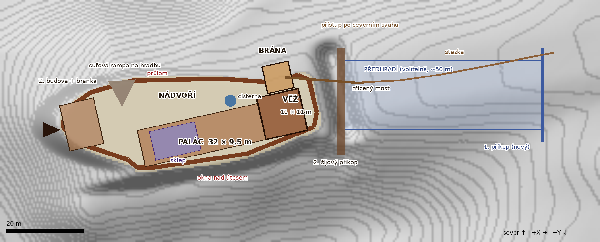

# 03 Ruin – plán stavby zříceniny

Cíl: na plošině ostrohu postavit zříceninu hradu ve stavu **blockout + hrubý vzhled**: správné rozměry, průchodnost a silueta ruiny, kamenný materiál a sutě. Detail přijde později.
Postup: **část generuje skript** (zdi, věž, palác podle půdorysu), **část se domodeluje ručně** v Modeling Mode podle pocitu.



> Stav: **návrh k doladění**. Půdorys, výšky i míra rozpadu se budou upravovat postupně podle potřeb hry.

---

## 1. Předloha: hrad Lapikus

Podle povrchového průzkumu (Archeologický ústav AV ČR, Brno):

| Prvek | Skutečnost |
|---|---|
| Poloha | skalní ostroh nad Plenkovickým potokem, 2,2 km ZSZ od Plavče (Znojemsko) |
| Stavba | 1364–1381 (Boček z Plavče, původně „Hrádek“); racionální dispozice typu Karlštejn / Radyně / Kašperk, na Moravě Ronov |
| Zánik | pustý nejpozději 1508, nejspíš po česko-uherských válkách (2. pol. 15. st.) |
| Příkopy | **dva šíjové příkopy** přes hřbet: první (~6–8 m široký), za ním **předhradí** ~50 m bez zástavby, pak druhý velký příkop před jádrem |
| Přístup | po **severním svahu** pod předhradím k velkému příkopu naproti bráně |
| Jádro – sever | **nádvoří**, ohradní zeď dochovaná v délce 43 m; **brána** s nárožním pilířem přiložená k hradbě, zpevněné opěrákem |
| Jádro – jih | **blokový palác** dlouhý 44 m nad nádvořím, západní konec 9,5 m široký, úzké okno k jihu; uvnitř příčky |
| Věž | východní, **věžovitá čelní část paláce ~11 × 11 m** (k příkopu) |
| Západ | budova s **vnější branou** (dochované jedno ostění a kapsa pro závoru) |

## 2. Herní verze: stav kolem roku 1540

Zřícenina je „dříve v čase“: zhruba **60–80 let po opuštění**. Zbývá víc než dnes:

| Prvek | Stav v roce ~1540 |
|---|---|
| Střechy, stropy, dřevo | spadlé a shnilé; z trámů zbyly jen kapsy ve zdech a pár trámů zaklíněných ve věži |
| Věž | stojí do **~17–21 m z ~24 m**, strana do nádvoří nahoře rozebraná (V do 11 m); uvnitř zbytky stropů, schodiště ve zdi částečně průchozí |
| Palác | **vnější (jižní) zeď nad útesem 8–11 m** s okny; **severní k nádvoří 4–8 m, u dveří až k zemi**; příčky 4–7 m; **sklep** pod západní částí s klenbou částečně propadlou |
| Hradba | **5–7 m** (vnější, špatně dostupná), u brány nižší; ochoz u rampy; jeden **průlom** na severu |
| Brána | gotický oblouk stojí, vrata pryč, **most přes příkop zřícený** (zbyly pilíře a trámy) |
| Západní budova | **1,5–4 m** (nízká a dostupná, rozebraná nejvíc), **branka** s ostěním vede ven na špičku ostrohu |
| Nádvoří | suťové kužely pod zdmi, **cisterna**, náletové dřeviny (bez, bříza, jeřáb), kopřivy u zdí |

## 3. Půdorys pro hru

Plošina má ~67 × 25 m a leží na Z ≈ **3129 cm**. Jižní hrana padá 7–8 m skalní stěnou.
Rozměry jsou zhruba 0,9× skutečnosti, aby se jádro vešlo na plošinu z heightmapy. Souřadnice jsou v UE cm, střed landscapu je 0, 0. Body jsou v `ruin_layout_draft.json`.

| Část | Rozměr | Poloha (střed, X / Y cm) | Výška zdí (~1540) | Tloušťka zdi |
|---|---|---|---|---|
| Hradba (plášť) | obvod ~150 m po hraně plošiny | – | 5–7 m, průlom ~1,5 m | 1,6–2,0 m |
| Palác | 32 × 9,5 m, podél jižní hrany | −900 / −860 | J 8–11 m, S 4–8 m, příčky 4–7 m | 1,4 m (příčky 0,8 m) |
| Věž | 11 × 11 m, východní konec paláce | 1190 / −1406 | 16–21 m (V do 11 m na S) | 2,5 m |
| Brána | 7 × 7 m, SV roh, oblouk 3,2 × 4,5 m | 1080 / −2355 | 5–7 m (oblouk chráněn) | 1,8 m |
| Most | ~9 m přes příkop k X ≈ 2700 | – | zbytky pilířů | – |
| Západní budova + branka | 9 × 12 m | −3990 / −1135 | 1,5–4 m | 1,2 m |
| Sklep | 12 × 7,5 m pod palácem, hloubka ~3 m | −1575 / −710 | klenba částečně propadlá | – |
| Cisterna | Ø ~3 m | −150 / −1750 | – | – |
| Suťová rampa na hradbu | SZ roh nádvoří | −2950 / −2050 | – | – |
| *Předhradí (volitelně)* | ~50 × 18 m na hřbetu za příkopem, nový 1. příkop u X ≈ 7900 | – | nízké zbytky ohrady | – |

Předhradí a první příkop vyžadují úpravu terénu: Sculpt v UE, nebo přegenerovat heightmapu s druhým příkopem. Rozhodne se později.

## 4. Rozpad do zříceniny

Rozpad nemá být náhodný šum. Generátor pracuje z **původní výšky** stavby a ubírá z ní ve dvou krocích:

1. **Přirozený rozpad časem – jen mírný.** Za 60–80 let zdivo samo ztratí ~10 % výšky: zubatá koruna, nižší pole mezi nárožími, V-zářezy nad otvory, sesuv nad útesem.
2. **Aktivní rozebírání – hlavní činitel.** Lidé z okolí berou hotový opracovaný kámen. Berou ho tam, **kde je to nejsnazší**. Rozhodují dvě věci:
   - **dostupnost zdi** (kap. 4.2)
   - **výška zdi**: co je v dosahu ze země, ze suti nebo ze žebříku (do ~8 m), se rozebere rychle. Na vysoké zdi se nahoře pracuje špatně a nebezpečně, takže jde rozebírání pomalu. Jakmile ale zeď klesne pod dosah, mizí rychle. **Nízké zdi a nízká místa ve zdi** (pod okny, u dveří, v průlomech) **proto zmizí nejvíc, vysoké zdi zůstávají.**

   Kde se rozebírá nejvíc:
   - z vnitřních zdí v nádvoří a v místnostech
   - u bran a dveří
   - shora po řadách, kam se dosáhne ze suti a lešení

   Vnější zdi nad srázem a vnější líc věže jsou špatně dostupné, a proto zůstávají vysoké.

Výsledek: **vnější plášť a věž vysoké, vnitřek a nízké stavby rozebrané, mezery u dveří a pod okny se rozšiřují.** Odpovídá to skutečným zříceninám a hodí se i pro hru. Silueta z dálky působí jako hrad, uvnitř jsou nízké zdi, přes které je vidět, dají se přelézt a jsou na nich místa k pohybu.

### 4.1 Jak se hrad rozpadá (v pořadí, jak to probíhá)

| # | Proces | Kdy | Co zanechá |
|---|---|---|---|
| 1 | **Střechy a dřevo:** krytina rozebraná, krovy a stropy shnijí a spadnou | 10–30 let | prázdné zdi bez ztužení, **kapsy po trámech** v řadách, zbytky trámů ve zdech |
| 2 | **Překlady nad otvory:** dřevěné překlady shnijí, nadezdívka nad okny a dveřmi se sesype | 20–50 let | **V-zářezy** nad otvory, z oken se stanou trhliny až ke koruně |
| 3 | **Koruna zdí:** mráz, voda a kořeny rozvolní horní řady kamene | průběžně | **stupňovitá, zubatá koruna**, nejnižší uprostřed polí |
| 4 | **Rohy a styky zdí** drží nejdéle (jsou nejtužší) | – | **„zuby“ na nárožích a u příček**, mezi nimi nižší úseky |
| 5 | **Rozebírání (kamenolom):** lidé berou kámen podle **dostupnosti a výšky** | od opuštění, **hlavní činitel** | **vnitřní zdi a příčky snížené shora po řadách** (rovnější, schodovitá koruna); u bran a dveří nejvíc; líc dole vylámaný, zůstává **jádro z lomu a malty**; vnější zdi nad útesem téměř netknuté |
| 6 | **Podemletí na hraně útesu:** zdi nad srázem ztrácí oporu | desítky let | části **zřícené ven, dolů ze srázu**, suť pod útesem |
| 7 | **Klenby** vydrží déle než stropy, ale praskají | 50+ let | klenba sklepa **propadlá v jednom místě**: otvor do sklepa |
| 8 | **Suť** se hromadí u pat zdí a v místnostech | průběžně | **suťové kužely** (sklon ~35°), podlahy místností zasypané 0,3–1,5 m |
| 9 | **Vegetace:** bez, kopřivy, bříza, jeřáb v sutích, mech na korunách | 20+ let | zelené koruny zdí, nálety v nádvoří |

### 4.2 Dostupnost a dochované výšky (stav ~1540)

**Dostupnost** (0 = nedostupné, 1 = nejsnáze dostupné) určuje, jak moc se zeď rozebrala. U bran a dveří se dostupnost místně zvyšuje.

| Část | Dostupnost | Původně | Dochováno | Poznámka |
|---|---|---|---|---|
| Věž – vnější strany (V k příkopu, J) | **0.03–0.05** | ~24 m | **17–21 m** | nejvyšší a nejméně dostupné místo |
| Věž – strany do nádvoří / paláce | 0.25–0.30 | ~24 m | 16–20 m, na S **V-zářez do 11 m** | vysoká, rozebírá se pomalu; schodiště ve zdi do 2. patra |
| Palác – jižní zeď nad útesem | **0.12** | ~13 m | **8–11 m** | okna 1. patra, menší sesuv nad útesem |
| Hradba – vnější plášť | **0.18** | ~9 m | **5–7 m** | střední výška → u brány a v průlomu níž; ochoz u SZ rampy |
| Brána | 0.40 | ~10 m | **5–7 m** | **oblouk chráněn** |
| Palác – severní zeď do nádvoří | **0.60** + dveře | ~13 m | **4–8 m**, u dveří až k zemi | špičky u styků s příčkami; nízká místa u dveří rozebrána nejvíc |
| Palác – příčky | **0.92** | ~13 m | **4–7 m** | vysoké původně, takže zůstalo víc; místnosti zasypané sutí |
| Západní budova | 0.35 + branka | ~7 m | **1,5–4 m** | **nízká stavba → rozebraná nejvíc**; jedno ostění branky dochované |
| Sklep | – | klenba | klenba ze 2/3 | propadlé místo = druhý vstup |

### 4.3 Pravidla pro generátor

Každá zeď v `ruin_layout.json` má **původní výšku**, **dostupnost** a volitelně **přístupová místa** (brána, dveře). Výsledná výška v každém místě zdi:

```
přirozeně = původní × WEATHER × profil_polí      (u rohů 1.0, uprostřed pole ~0.88)
            − V_zářez_nad_otvory                 (shnilé překlady)
            + zubatost_koruny                    (malá, ±0,3–0,7 m)
rozebráno = výsledek rozebírání z výšky „přirozeně“:
            rychlost = ROBBING × dostupnost(x) × min(1, REACH / aktuální_výška)
            (v dosahu plnou rychlostí, vysoká zeď pomalu; dostupnost roste u přístupových míst)
            + nerovnost_rozebírání               (delší, rovnější úseky)
výška     = rozebráno (průlomy jsou zadané předem, takže se rozebírají dál), zarovnáno na řady kamene 30 cm
            (chráněné prvky nikdy pod minimum)
```

| Parametr | Výchozí | Účinek |
|---|---|---|
| `WEATHER` | 0.9 | kolik výšky zbude po samotném přirozeném rozpadu (1 = nic) |
| `ROBBING` | 4.75 | rychlost rozebírání (m za období) při dostupnosti 1 a zdi v dosahu |
| `REACH` | 8 m | do jaké výšky se kámen bere snadno (ze země, suti, žebříku, lešení) |
| `ACCESS_BOOST` / `ACCESS_RADIUS` | 0.3 / 6 m | o kolik a jak daleko se zvýší dostupnost kolem brány a dveří |
| `CORNER_STRENGTH` | 0.2 | o kolik jsou nároží vyšší než pole |
| `SEED` | 1 | jiná varianta nerovností, ne jiné průlomy |
| `FRAME_REACH` | 2,5 m | do jaké výšky se vylámou ostění oblouků (portál, brána) |
| `OPENING_TYPES` | – | typy otvorů: šířka ostění, nadpraží (kámen / dřevo / oblouk), cennost (kap. 4.4) |
| `RUBBLE_FACTOR` | 0.25 | kolik chybějícího zdiva zůstane jako suť (u rozebíraných zdí většina kamene odvezena) |

Jednu zeď lze kdykoli „zachránit“ nebo „rozebrat“ změnou její dostupnosti v JSON. Pravidla pro hru: **vnější a vysoké zdi zůstávají, vnitřní a nízké mizí.**

**Suť:**

- objem chybějícího zdiva × `RUBBLE_FACTOR` se rozloží do kuželů u paty zdi
- zdi nad útesem: 70 % ven dolů ze srázu (přirozený sesuv)
- rozebírané vnitřní zdi: málo suti, jen odpad z opracování a nepoužitelné kusy
- ostatní zdi: 60 % dovnitř

**Hratelnost má přednost před náhodou.** Chráněné prvky se nikdy nerozpadnou pod minimum:

- ochoz u rampy
- schodiště ve věži
- oblouk brány
- průchody ≥ 1,2 m
- rampy ≤ 40°

Průlomy a propadlá klenba jsou v JSON zadané ručně, kde mají herní smysl.

### 4.4 Otvory: okna, střílny, dveře a brána

Otvory mají **opracované kamenné ostění** (šambrány, nadpraží, parapety). Je to nejcennější kámen na hradě, a proto mizí jako první, pokud je dostupný. Co se s otvorem stane, určuje jeho **typ**, **dostupnost zdi v jeho místě** a **výška**: ostění vysoko ve zdi se bere hůř.

| Typ | Původně | Když je nedostupný | Když je dostupný (ostění vylámané) |
|---|---|---|---|
| **Střílna** | štěrbina 0,2 × 1–1,3 m v kamenném ostění, uvnitř široký šikmý výklenek | celá (věž, hradba zvenku, palác nad útesem) | štěrbina se rozšíří, zevnitř se výklenek otevře do nepravidelné díry |
| **Okno** | kamenné ostění + nadpraží, výklenek se sedátky | **ostění i nadpraží celé** (okna paláce nad útesem): herní průhled s rámem | ostění vylámané → otvor širší o ~0,3 m na stranu, vylámaný parapet, **nadpraží spadne → V-zářez** |
| **Okno s dřevěným překladem** | bez kamenného ostění | překlad shnije → V-zářez | totéž |
| **Dveře** | kamenný portál s nadpražím | celé | jedno ostění: otvor širší z jedné strany, nadpraží drží; **obě ostění: nadpraží spadne → V-zářez**, otvor se mění v mezeru (v rozebrané zdi až k zemi) |
| **Portál (oblouk)** | klenutý portál | celý | **spodní ostění vylámaná do ~2,5 m**, oblouk nad nimi „visí“ a drží |
| **Brána** | oblouk 3,2 × 4,5 m, kapsa pro padací most, otvory pro řetězy, drážka pro mříž, kapsy pro závoru v průjezdu | – | **oblouk chráněn** (herní orientační bod); spodní ostění vylámaná do 2,5 m; dřevo (vrata, mříž, most) pryč; zůstanou **kapsa po mostu, otvory pro řetězy, drážky a kapsy pro závoru** |

**Pravidla generátoru:**

- skóre = dostupnost × cennost typu × min(1, `REACH` / (parapet + 1,5 m)) + malá náhoda
- pod 0,25 zůstane ostění celé, 0,25–0,42 se vylámá jedno ostění, nad 0,42 obě
- kamenné nadpraží spadne jen bez obou ostění, dřevěný překlad shnije vždy
- otvory snižují zeď kolem sebe (V-zářez) → nízká místa → rozebírání tam pokračuje rychleji: mezery u dveří se rozšiřují
- ruční přepis v JSON: `robbed: none / one / both`, `side: l / r`, `protect: true` (oblouk brány, portál)

**Výsledek v nákresu:**

| Místo | Stav |
|---|---|
| Palác nad útesem | okna 1. patra s **celým ostěním** |
| Palác do nádvoří | dveře jako **široké mezery**, portál s vylámanými spodními ostěními |
| Věž | vstup v 1. patře s jedním vylámaným ostěním; střílny celé |
| Hradba | střílny celé |
| Brána | oblouk stojí, kapsa po mostu a otvory pro řetězy viditelné |
| Západní branka | jedno ostění s kapsou pro závoru (jako na skutečném Lapiku) |

### 4.5 Co generátor neudělá (ruční průchod)

- rozvolněné jednotlivé kameny na koruně a nárožích
- vylámaný líc s viditelným jádrem: v blockoutu jen vlysem / ustoupeným segmentem, ve vzhledu materiálem
- výklenky střílen a oken zevnitř (šikmá ostění, sedátka), drážka pro mříž a kapsy pro závoru v průjezdu brány
- zaklíněné trámy, pootevřená kamenná ostění, praskliny
- doladění siluety z hlavních pohledů: z cesty od východu, z protějšího břehu, z nádvoří

## 5. Hratelnost

| Místo | Co hráč dělá | Jak se tam dostane |
|---|---|---|
| **Brána** | vstup do jádra | přes příkop: po trámu zříceného mostu, nebo dolů do příkopu a nahoru po suti |
| **Nádvoří** | orientace, výhled na věž | bránou nebo západní brankou |
| **Hradba – ochoz** | výhled na řeku, přehled nádvoří | suťová rampa v SZ rohu; úsek ochozu mezi rampou a průlomem |
| **Průlom** | průhled ze severu do nádvoří, zkratka ze svahu | lezení po suti zvenku |
| **Věž** | nejvyšší vyhlídka, skrýš v patře | přízemí rozvalinou, nahoru schodištěm ve zdi / zaklíněnými trámy |
| **Palác** | interiér, místnosti s příčkami | dveřní otvory z nádvoří |
| **Okna nad útesem** | průhled na jih, nebezpečný okraj | z paláce |
| **Sklep** | temná skrýš, místo pro předmět | propadlá klenba nebo schody z paláce |
| **Cisterna** | skrýš / předmět | z nádvoří |
| **Branka na Z** | tajný odchod na špičku ostrohu | ze západní budovy |

Rozměry pro postavu (Character Movement):

- průchod ≥ 1,2 m
- dveře 1,0 × 2,2 m
- schod max ~45 cm (Max Step Height)
- rampy ≤ 44° (Walkable Floor Angle)
- nízké zídky do 50 cm jdou přejít, vyšší ne

## 6. Postup stavby

### Krok 1 – podklad půdorysu (hotovo – `build/ruin_layout.json`)

`ruin_layout.json` s prvky:

- zdi jako lomené čáry s tloušťkou a výškou
- profil rozpadu: výška po délce zdi
- otvory: brány, okna, dveře, průlomy, kapsy po trámech
- podlahy, schody, rampy, sutě

Vychází z `ruin_layout_draft.json` a ladí se v něm.

### Krok 2 – generátor v UE: `build_ruin.py` (hotovo – návod `build/README_build_ruin.md`)

- staví zdi z `SM_Cube` (`LevelPrototyping`) po segmentech ~0,5–1 m
  - rozpadlá koruna: náhodné výšky v pásmu profilu
  - otvory podle JSON a jejich stav podle kap. 4.4 (celé ostění = tmavší rámeček, vylámané = rozšířený otvor)
  - paty zdí sahají až do terénu, takže zdi na hraně útesu nevisí ve vzduchu
- věž: patra a otvory po trámech
- schody a rampy podle hratelnosti
- rozpad podle kap. 4.3: mírný přirozený rozpad + rozebírání podle dostupnosti a výšky, V-zářezy, suťové kužely (`SM_Rock`)
- vše do Outliner složek `Ruin/<Část>` s tagem `Zricenina_Ruin`; opakované spuštění staré smaže a postaví znovu
- parametry nahoře ve skriptu: `SEED`, `WEATHER`, `ROBBING`, `REACH`, `ACCESS_BOOST`, `ACCESS_RADIUS`, `CORNER_STRENGTH`, `RUBBLE_FACTOR`

### Krok 3 – sloučení a ruční domodelování (ty)

1. Vybrat segmenty jedné části → **Actor → Merge Actors** do statického meshe, např. `SM_Ruin_Palace`.
2. **Modeling Mode** (Shift+5):
   - **Boolean** na oblouky a okna
   - **PolyEdit** na rozpadlé hrany
   - **Displace / Smooth** na nepravidelnost
   - **Plane Cut** na šikmé zlomy
3. Ruční detaily: zaklíněné trámy, vypadlé kameny, ostění branky.

### Krok 4 – hrubý vzhled

| Co | Jak |
|---|---|
| Zdivo | materiál `M_RuinStone_WA` s **world-aligned (triplanar)** texturou, nepotřebuje UV; StarterContent `T_Brick_Hewn_Stone_*`, `T_Rock_Slate_*`, případně CC0 z [Poly Haven](https://polyhaven.com/textures) / [ambientCG](https://ambientcg.com) (lomové zdivo, „castle wall“) |
| Mech a špína | ve stejném materiálu podle normály: mech na horních plochách, tmavé zatečení pod korunou |
| Sutě | `SM_Rock` (scale 0.2–1.5) u pat zdí a v suťových kuželích; později přes PCG |
| Trámy | `SM_Cube` + `M_Wood_Oak` / `M_Wood_Pine` |
| Vegetace | z 04: kopřivy a bez u zdí, bříza a jeřáb v sutích, břečťan později |

### Krok 5 – hratelnostní průchod

Play s postavou. Kontrolovat:

- kolize
- schody a rampy
- místa, kde se postava zasekne
- výhledy z věže a ochozu

Opravy dělat v JSON nebo ručně.

## 7. Proč tento postup

| Možnost | Pro | Proti |
|---|---|---|
| **Skript + ruční domodelování** (zvoleno) | přesně podle půdorysu, opakovatelné, rychlé změny rozměrů; ruka dodá charakter | blockout z kostek je třeba sloučit, než se domodeluje |
| Jen ruční Modeling Mode | plná kontrola | pomalé, těžko se mění rozměry |
| Modulární kit z Fabu | rychle hezké | nesedí na půdorys Lapiku, styl může nesedět |
| Blender | nejvíc kontroly | další program a export |

## 8. Checklist

1. ☐ Odsouhlasit půdorys, stav ~1540 a rozpad podle dostupnosti (kap. 2–4, nákresy), rozhodnout o předhradí
2. ☑ `build/ruin_layout.json` + `build/build_ruin.py` (návod `build/README_build_ruin.md`)
3. ☐ Spustit generátor, Play test měřítka
4. ☐ Ladění rozpadu a výšek (JSON / parametry)
5. ☐ Merge Actors po částech, domodelování v Modeling Mode
6. ☐ Materiál `M_RuinStone_WA`, sutě
7. ☐ Hratelnostní průchod (kap. 5)
8. ☐ Upravit spline `PCG_NoForest` podle hotové ruiny (04_forest)

## Soubory

| Soubor | Obsah |
|---|---|
| `README_ruin.md` | tento plán |
| `Zricenina_hrad_plan.png` | návrh půdorysu na terénu (sever nahoře, měřítko 20 m) |
| `Zricenina_rozpad_pohledy.png` | odhad rozpadu – rozvinuté pohledy na zdi (původní obrys, dochované zdivo, dostupnost) |
| `Zricenina_rozpad_hmota.png` | hmotový náčrt celé ruiny ze dvou stran |
| `build/` | generátor: `build_ruin.py`, `ruin_layout.json`, návod `README_build_ruin.md`, náhled |
| `ruin_layout_draft.json` | návrh obrysů v UE cm: hradba, palác, věž, brána, západní budova, sklep, cisterna, rampa |

## Zdroje

- [Archeologický ústav AV ČR Brno – Přehled výzkumů: hrad Lapikus (povrchový průzkum)](https://app2.ssc.avcr.cz/ARUB-prehled-vyzkumu/files/22206.pdf)
- [Archeologický ústav AV ČR Brno – Přehled výzkumů (něm. resumé)](https://app2.ssc.avcr.cz/ARUB-prehled-vyzkumu/files/22207.pdf)
- [hrady.cz – Lapikus](https://www.hrady.cz/hrad-lapikus-plenkovicky-hrad)
- [Kudy z nudy – Zřícenina hradu Lapikus](https://www.kudyznudy.cz/aktivity/zriceninu-hradu-lapikus)
- [Jevišovicko – Lapikus](https://jevisovice.info/aktivity/castle-ruins-lapikus)
