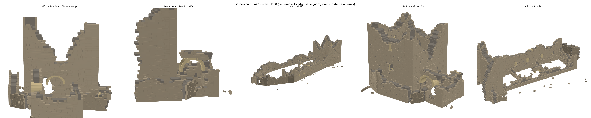

# 03 Ruin – zřícenina z kamenných bloků (stav ~1650) – návod pro UE 5.8

Nová metoda generování: zřícenina se skládá **z jednotlivých kamenných bloků** (~18 500 kusů) místo svislých sloupců.

- Okna, průchody a výšky zdí upravíš **bouracími objemy přímo v levelu** (Trigger Box s tagem, kap. 5) nebo v datech (kap. 4) a přegeneruješ.
- Jednotlivé kameny můžeš rozložit na samostatné actory, ručně posunout a smazat. Změny se pamatují i po přegenerování.



Původní sloupcový generátor (`03_ruin\build`) zůstává beze změny. Obě metody používají tag `Zricenina_Ruin`, takže generují do stejných složek a navzájem se přepisují.

---

## Jak je zeď složená

| Vrstva | Co to je | Materiál (výchozí) |
|---|---|---|
| **Líc** (obě strany zdi) | lomové kvádry v řádcích 25–40 cm, délky 35–90 cm, převazba (spáry se střídají) | `M_Brick_Hewn_Stone` |
| **Jádro** (mezi líci) | delší bloky z lomu a malty 1,0–1,8 m | `M_Concrete_Grime` (šedé) |
| **Ostění a oblouky** | opracované kvádry kolem intaktních otvorů, klínové kameny oblouků | `M_Rock_Sandstone` (světlé) |
| **Nárožní kvádry** | zakrývají průřez zdi v rozích | jako líc |

**Rozpad** jde v tomto pořadí:

1. **Výška zdi:** model rozpadu z `README_ruin.md` kap. 4 (čas, rozebírání podle dostupnosti a výšky, otvory) určí, jak vysoko zeď v daném místě sahá.
2. **Bloky nad touto výškou zmizí.** Na koruně zůstanou jednotlivé uvolněné a pootočené kameny.
3. **Podpora:** blok bez opory pod sebou nezůstane (výjimka: je nad intaktním nadpražím nebo obloukem).
4. **Rozebraný líc:** u paty na dostupné straně líc mizí a odhalí šedé jádro. Vnější líc nad útesem zůstává.
5. **Otvory:** bloky v otvorech se vyřízmou. Intaktní ostění a oblouky se postaví z opracovaných kvádrů.
6. **Suť:** jen málo bloků u paty, protože většinu kamene lidé odvezli.

---

## 1. Příprava (jednorázově)

1. Zkopíruj obsah složky `03_ruin\blocks` kamkoli. Soubory `build_ruin_blocks.py`, `ruin_layout.json` a `manual_edits.json` musí zůstat **vedle sebe**.
2. **Záložní Blueprint (doporučeno vytvořit hned).** Skript se nejdřív pokusí přidat komponentu Instanced Static Mesh sám. Kdyby to v UE 5.8 nešlo, použije tento Blueprint:
   1. Content Browser → `Skvt/Lapikus/Ruin` → pravé tlačítko → **Blueprint Class → Actor** → `BP_RuinBlocks`.
   2. Otevři ho a v panelu Components dej **Add → Instanced Static Mesh**. Komponentu nech, jak je, nic nenastavuj.
   3. **Compile** a **Save**.
3. **Ulož mapu a commitni.** Před generováním smaž sloupcovou zříceninu, pokud v mapě je. Nová ji sice smaže sama, ale sloučené meshe smazat musíš ručně.

---

## 2. Vygenerování

1. Otevři `LapikusPrototypeMap` a otevři **Output Log**.
2. Dej **Tools → Execute Python Script…** a vyber `build_ruin_blocks.py`.
3. Průběh je vidět v okně „Stavím zříceninu z bloků…“, po jednotlivých zdech.
4. Output Log pak vypíše:
   ```
   Zricenina z bloku (1650): 18... bloku ve 17 zdech, objemu 0, samostatnych kamenu 0, rucne smazanych 0, posunutych 0.
   ```
5. V Outlineru se objeví složky `Ruin/Hradba`, `Ruin/Palac`, `Ruin/Vez`, `Ruin/Brana` a `Ruin/ZapadniBudova`. Každá zeď má až 3 actory: `<Zed>_Lic`, `<Zed>_Jadro` a `<Zed>_Osteni`. Každý z nich je jeden Instanced Static Mesh s mnoha bloky.

**Rychlé ladění jedné zdi:** nahoře ve skriptu nastav `ONLY_WALLS = ["Brana_V", "Brana_J"]`. Přegeneruje se jen tato zeď, ostatní zůstanou.

**Když to selže:**

- **„Nejde pridat InstancedStaticMeshComponent… chybi Blueprint“:** vytvoř `BP_RuinBlocks` (krok 1.2).
- **Chybí soubor:** v `build_ruin_blocks.py` nastav `LAYOUT_PATH = r"…\ruin_layout.json"`.
- **Jiná chyba:** pošli text z Output Logu.

---

## 3. Stáří zříceniny

V `ruin_layout.json` je `"age": "1650"` a sekce `presets`. Přepnout jde i nahoře ve skriptu: `AGE = "1540"`.

| Stáří | Věž | Palác nad útesem | Hradba | Vnitřek (palác do nádvoří, příčky, západní budova) | Suť |
|---|---|---|---|---|---|
| `1540` (60–80 let po opuštění) | 17–21 m | 8–11 m | 5–7 m | 2–8 m | střední |
| **`1650`** (~170 let, výchozí) | **12–14 m** | **5–7 m** | **3–5 m** | **1–2 m**, portál a oblouk brány stojí | **malá**, odvezená |

Preset `1650` mění parametry takto:

| Parametr | 1650 | Význam |
|---|---|---|
| `WEATHER` | 0.6 | víc přirozeného rozpadu |
| `ROBBING` | 7 | víc rozebíráno |
| `REMAIN` | 1,2 m | spodní řady zasypané zeminou zůstávají |
| `JAG` | 1.8 | zubatější koruna |
| `FRAME_ROB` | 1.4 | víc vylámaných ostění |
| `FACE_ROB` | 1.4 | víc odkrytého jádra |
| `RUBBLE_*` | malé | suť většinou odvezená |

Vlastní stáří přidáš novým presetem v `presets` (např. `"1800": {...}`) a nastavíš `"age": "1800"`.

---

## 4. Úpravy v datech (nedestruktivní)

Do `ruin_layout.json` → `"edits": [ ... ]` přidej operace a spusť skript znovu. Ukázky jsou v `"edits_examples"`. Zkopíruj je do `"edits"` a uprav.

| Operace | Zápis | Co udělá |
|---|---|---|
| **vybourat otvor ve zdi** (pohodlněji objemem, kap. 5) | `{"op": "cut", "wall": "Palac_J", "s0": 21.0, "s1": 22.2, "z0": 5.6, "z1": 7.8}` | odstraní bloky v obdélníku: `s` = metry podél zdi od jejího prvního bodu, `z` = metry od paty |
| **průchod přes více zdí** | `{"op": "cut_box", "box": [x0, y0, z0, x1, y1, z1]}` | odstraní bloky ve světovém kvádru (UE cm); `wall` lze vynechat = všechny zdi |
| **nastavit výšku** | `{"op": "set_height", "wall": "Hradba_Z_S", "s0": 37, "s1": 46, "h": 5.2}` | úsek zdi bude přesně `h` m |
| **zachránit / zvýšit** | `{"op": "restore", "wall": "Vez_S", "s0": 0, "s1": 11, "h": 14.0}` | úsek bude alespoň `h` m (rozpad ho nesníží) |

Tipy:

- **Kde je `s`:** v sekci `walls` má každá zeď `points` (UE cm). `s` se měří od prvního bodu v metrech. Délku úseku zjistíš v UE měřením (prostřední tlačítko myši + tah v Top/Side view).
- **Hledání `box`:** vlož do levelu kostku, umísti ji na místo průchodu a z Details opiš Location ± polovinu Scale × 50.
- **Typy otvorů a celé zdi** (výška `H0`, dostupnost `access`, otvory `openings`) se mění v `walls` (viz `03_ruin\build\README_build_ruin.md` kap. 3).
- Datové úpravy **neposouvají ostatní bloky**. Každý blok má vlastní náhodu podle svého ID, takže zbytek zříceniny zůstane stejný.

---

## 5. Úpravy přímo v levelu: bourací objemy (doporučeno)

Každá zeď je v levelu jeden Instanced Static Mesh. Kliknutím proto vybereš celou zeď, ne jednotlivý blok. Na úpravy jsou určené **objemy**: do levelu vložíš **Trigger Box**, dáš mu tag a přegeneruješ. Skript si objemy při každém spuštění načte sám. Posunem nebo zvětšením boxu a novým spuštěním úpravu upravíš, smazáním boxu ji vrátíš.

### 5.1 Vložení objemu

1. **Window → Place Actors**, vyhledej **Trigger Box** a přetáhni ho k místu na zdi.
2. Box **musí protínat osu zdi**. Nastav ho přes gizmo nebo v Details → Transform. Rozměr Trigger Boxu je 2 × Box Extent × Scale. Pro vstup do věže stačí třeba šířka 1,4 m, výška 2,6 m a hloubka 4 m, aby box prošel celou zdí.
3. V Details → **Actor → Tags** přidej tag nebo více tagů:

| Tag | Co udělá |
|---|---|
| `Ruin_Opening:dvere` | **dveře** v místě boxu (kamenné ostění + nadpraží; podle dostupnosti se může vylámat) |
| `Ruin_Opening:portal` | **klenutý portál** (oblouk z klínových kamenů) |
| `Ruin_Opening:okno` / `Ruin_Opening:strilna` | **okno / střílna** (spodek boxu = parapet) |
| `Ruin_Opening:brana` | **brána** (velký oblouk) |
| `Ruin_Opening:prulom` | **vybouraný průchod** bez ostění, nepravidelný horní okraj |
| `Ruin_Intact` (spolu s Opening) | ostění se nevylámá, otvor zůstane jako nový |
| `Ruin_Protect` (spolu s Opening) | oblouk se nezřítí |
| `Ruin_Cut` | **vyřízne vše** uvnitř boxu (hrubá díra, i přes víc zdí) |
| `Ruin_Keep` | zdi v boxu se **nerozpadnou pod vršek boxu** (zvýšení / záchrana úseku) |
| `Ruin_Explode` | bloky uvnitř boxu se vytvoří jako **samostatné kameny** pro ruční posun a mazání (kap. 5.2) |

4. Spusť `build_ruin_blocks.py`. Output Log vypíše mimo jiné počet načtených objemů.

**Rozdíl mezi `Ruin_Opening` a `Ruin_Cut`:**

- **`Ruin_Opening`** vytvoří skutečný otvor se vším, co k tomu patří: ostění, nadpraží, oblouk a rozpad podle dostupnosti. Například dveře v dostupné zdi mohou mít vylámané ostění a V-zářez.
- **`Ruin_Cut`** jen vyřízne bloky. Hodí se na hrubé díry a průlomy.

**Vstup do věže** je teď v datech rovnou: **vybouraný průchod (`prulom`) v přízemí severní strany věže z nádvoří**, 1,4 × 2,6 m. Další vstup z paláce do věže přidáš boxem s tagy `Ruin_Opening:portal` a `Ruin_Protect` přes západní zeď věže. Ukázka je v `ruin_layout.json` → `volumes_examples`.

Doporučení:

- Objemy si dej do vlastní složky v Outlineru, např. `Ruin_Objemy`.
- Pojmenuj je podle účelu, např. `Vstup_vez_z_palace`.
- Trigger Box se ve hře nezobrazuje a postavě nebrání. Může v levelu zůstat napořád.

### 5.2 Ruční posun a mazání jednotlivých kamenů

1. Přes místo, které chceš ručně doladit, polož Trigger Box s tagem **`Ruin_Explode`** a přegeneruj.
2. Bloky v boxu jsou teď **samostatné actory** ve složce `Ruin/<Část>/Kameny` s názvem `Kamen_<ID>`. Jde je vybírat, posouvat, otáčet i mazat jako běžné objekty. Box drž malý, každý kámen je jeden actor.
3. Po úpravách nastav nahoře v `build_ruin_blocks.py` `MODE = "capture"` a spusť ho. Do `manual_edits.json` se zapíšou:
   - **smazané** kameny (`removed`)
   - **posunuté a pootočené** kameny (`moved`)
4. Vrať `MODE = "build"`. Při dalším generování zůstanou smazané kameny smazané a posunuté na novém místě. Platí to i po změně stáří nebo dalších úprav.
5. **Vrácení:** smaž záznam z `manual_edits.json`, nebo soubor přepiš na `{"removed": [], "moved": {}}`.

Pozor: capture spouštěj vždy **před** dalším generováním. Generování ruční změny bez capture přepíše.

## 6. Dál: sloučení a vzhled

- Až bude rozpad hotový, můžeš každou část sloučit přes **Tools → Merge Actors** (Instanced Static Mesh je podporovaný) do jednoho meshe pro Modeling Mode. Po sloučení už ale nejde jednoduše přegenerovat, takže si nejdřív zálohuj JSON a `manual_edits.json`.
- Materiály jsou nahoře ve skriptu (`MAT_FACE`, `MAT_CORE`, `MAT_FRAME`). Pro hrubý vzhled později `M_RuinStone_WA` (world-aligned), `README_ruin.md` kap. 6, krok 4.
- **Výkon:** ~18 500 instancí kostky je pro UE nenáročné. Pro jemnější bloky (`STONE_MIN/MAX`, `COURSE_MIN/MAX` v `params`) počítej se 2–4× víc.

---

## Parametry bloků (`ruin_layout.json` → `params`)

| Parametr | Výchozí | Význam |
|---|---|---|
| `COURSE_MIN` / `COURSE_MAX` | 0.25 / 0.40 m | výška řádků |
| `STONE_MIN` / `STONE_MAX` | 0.35 / 0.90 m | délka lícových kvádrů |
| `CORE_MIN` / `CORE_MAX` | 1.0 / 1.8 m | délka bloků jádra |
| `FACE_DEPTH` | 0.40 m | hloubka lícových kvádrů |
| `JOINT` | 0.015 m | spára mezi bloky |
| `FACE_ROB` / `FACE_ROB_H` | 1.0 / 2.2 m | síla a výška rozebírání líce u paty (odkryté jádro) |
| `RUBBLE_BLOCKS` | 0.02 | podíl bloků jako suť u paty |
| `SEED` | 1 | jiná varianta celé zříceniny |

---

## Soubory

| Soubor | Obsah |
|---|---|
| `build_ruin_blocks.py` | generátor z bloků (čistý Python), `MODE = "build"` / `"capture"`; mimo UE vypíše počty bloků |
| `ruin_layout.json` | zdi, otvory, presety stáří, `edits`, `edits_examples`, `volumes_examples`, výšková mřížka terénu |
| `manual_edits.json` | ručně smazané (`removed`) a posunuté (`moved`) kameny |
| `Zricenina_bloky_nahled.png` | náhled (věž z nádvoří, brána detail, celek, brána a věž, palác) |
| `..\..\tools\ruin\check_blocks.py` | vykreslí náhled bez Unrealu |
| `..\..\tools\ruin\gen_layout.py` | vytvoří `ruin_layout.json` z `ruin_layout_draft.json` a heightmapy |
