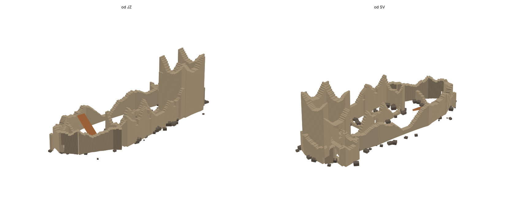

# 03 Ruin – generování zříceniny v Unreal Editoru 5.8 (krok za krokem)

Skript `build_ruin.py` postaví v mapě **blockout zříceniny** podle `ruin_layout.json`. Používá model rozpadu z `README_ruin.md` kap. 4:

- mírný přirozený rozpad
- rozebírání podle dostupnosti a výšky
- vylámaná ostění oken, dveří a brány

Zdi jsou složené z kostek po 0,5 m. Výsledek je hrubá hmota k testování průchodnosti a měřítka, kterou pak ručně sloučíš a domodeluješ.



---

## 0. Co je potřeba

| Co | Stav |
|---|---|
| Mapa `LapikusPrototypeMap` s landscapem z `01_terrain` (Location 0, 0, 3200, Scale 50 / 50 / 12.5) | ✅ |
| Plugin **Python Editor Script Plugin** (zapnutý už kvůli řece) | ✅ |
| `LevelPrototyping` a `StarterContent` v projektu (materiál `MI_PrototypeGrid_Gray`, kameny `SM_Rock`) | ✅ |
| Soubory `build_ruin.py` a `ruin_layout.json` **ve stejné složce** | tato složka `03_ruin\build` |

Skript nic nemaže mimo actory, které sám vytvořil (tag `Zricenina_Ruin`).

**Doporučení:** před prvním spuštěním ulož mapu a commitni ji. Případně si nejdřív vyzkoušej skript na kopii mapy (Content Browser → pravé tlačítko na mapu → Duplicate).

---

## 1. Spuštění

1. Otevři `LapikusPrototypeMap`. Přepni se do **Selection Mode** (Shift+1) a nic nevybírej.
2. Otevři **Window → Output Log**. Zprávy skriptu se vypisují tam.
3. **Tools → Execute Python Script…** → vyber `build_ruin.py` ze složky `03_ruin\build`.
4. Objeví se okno **„Stavím zříceninu…“** s průběhem. Trvá to pár sekund až desítky sekund: vytvoří se ~590 dílů zdí, ~100 kamenů a 1 rampa.
5. V Output Logu se objeví:
   ```
   Zricenina: 591 dilu zdi, 101 kamenu, 1 ramp (sklon 31 st). Tag Zricenina_Ruin.
   ```

**Když se skript nespustí:**

- **Chyba „Nastav LAYOUT_PATH…“ nebo „No such file“:** otevři `build_ruin.py` v textovém editoru a nahoře nastav plnou cestu:
  ```python
  LAYOUT_PATH = r"C:\Users\JDr\GitHub\GameDesign\Claude outputs\Lapikus\03_ruin\build\ruin_layout.json"
  ```
- **Jiná chyba:** zkopíruj ji z Output Logu do chatu. Skript v Unrealu ještě neběžel, takže první spuštění je zároveň test. Názvy v Python API se mezi verzemi občas liší a skript se pak rychle upraví.

**Alternativa přes příkazový řádek:** v Output Logu přepni **Cmd → Python** a zadej:

```
exec(open(r"C:\Users\JDr\GitHub\GameDesign\Claude outputs\Lapikus\03_ruin\build\build_ruin.py", encoding="utf-8").read())
```

V tom případě musí být `LAYOUT_PATH` vyplněná, protože `__file__` není k dispozici.

---

## 2. Kontrola výsledku

1. **Outliner:** vznikne složka **Ruin** s podsložkami:

| Složka | Obsah |
|---|---|
| `Ruin/Hradba` | dva úseky hradby (Hradba_Z_S, Hradba_V) + `Sut` |
| `Ruin/Palac` | jižní, severní a západní zeď, 2 příčky + `Sut` |
| `Ruin/Vez` | 4 strany věže + `Sut` |
| `Ruin/Brana` | 4 strany brány (vjezd z východu, průchod na jih do nádvoří) + `Sut` |
| `Ruin/ZapadniBudova` | východní a severní zeď (vnější zdi tvoří hradba s brankou) |
| `Ruin/Rampa` | suťová rampa na ochoz hradby |

2. **Top view (Alt+J):** porovnej s `03_ruin\Zricenina_hrad_plan.png`. Hrad má sedět na plošině u příkopu a brána v SV rohu.
3. **Perspektiva:** vnější zdi (palác nad útesem, věž, hradba) musí být vysoké, vnitřní (severní zeď paláce, příčky, západní budova) nízké. Porovnej s `Zricenina_rozpad_hmota.png`.
4. **Play** (s Player Startem na hřbetu za příkopem, viz `01_terrain`). Projdi:

| Místo | Co ověřit |
|---|---|
| Brána | vstoupíš z východu, projdeš na jih do nádvoří |
| Rampa | vyjdeš na ochoz hradby (sklon 31°) |
| Průlom v severní hradbě | dá se přelézt po suti |
| Palác | vstup dveřními mezerami, výhled okny nad útesem |
| Západní branka | vede ven na špičku ostrohu |

Pokud postava mezi kostkami drhne, v této fázi to nevadí. Opraví to sloučení v kroku 4.

---

## 3. Ladění a opakované spuštění

Skript jde spouštět znovu, kolikrát chceš. **Nejdřív smaže vše s tagem `Zricenina_Ruin` a postaví znovu.** Celou akci vrátíš přes Ctrl+Z.

### Rychlé úpravy v `build_ruin.py` (nahoře)

```python
OVERRIDE = {"ROBBING": 3.5}     # méně rozebrané
OVERRIDE = {"ROBBING": 6.0}     # víc rozebrané
OVERRIDE = {"SEED": 2}          # jiná varianta nerovností (průlomy zůstávají)
OVERRIDE = {"COLUMN": 1.0}      # hrubší díly (méně actorů, rychlejší)
ROCK_MESH = None                # bez suti
MATERIAL = None                 # bez šedého gridu
```

### Úpravy v `ruin_layout.json` (sekce `walls`)

Každá zeď má:

| Klíč | Význam | Příklad úpravy |
|---|---|---|
| `H0` | původní výška (m) | příčky nižší: `13.0` → `8.0` |
| `access` | dostupnost 0–1 | zachránit zeď: `0.6` → `0.3` |
| `access_points` | místa (m od začátku zdi), kde se rozebírá víc | odebrat → zeď kolem dveří vyšší |
| `openings` | otvory: `kind`, `s`, `w`, `sill`, `h` | užší mezera po dveřích: přidat `"robbed": "one"` |
| `breaches` | ruční průlomy `s0`, `s1`, `floor` | posunout / smazat průlom |
| `protect` | minimální výška v úseku | ochoz, oblouk brány |
| `thickness` | tloušťka (m) | |

Typy otvorů (`kind`): `strilna`, `okno`, `okno_drevo`, `dvere`, `portal`, `brana`.

Vlastnosti otvorů:

- `protect: true`: oblouk se nezřítí
- `robbed: none / one / both`: ruční stav ostění
- `side: l / r`: které ostění se vylámalo

Rampy jsou v sekci `ramps`: `start`, `end` (UE cm) a `top` (výška konce nad plošinou v m).

**Kontrola bez Unrealu (volitelně):** `python build_ruin.py ruin_layout.json` vypíše počet dílů a výšky zdí. `tools\ruin\check3d.py` vykreslí náhled.

---

## 4. Sloučení do meshů (až je rozpad odladěný)

Kostky jsou jen stavební materiál. Pro další práci je slouč po částech.

1. V Outlineru klikni pravým na složku, např. **Ruin/Palac**, a dej **Select → All Descendants**. Kameny ze `Sut` z výběru odeber: Ctrl+klik na složku `Sut`, nebo ji slučuj zvlášť.
2. **Tools → Merge Actors**. Nastav:
   - **Merge Method:** Merge
   - **Pivot Point at Zero:** vypnuto
   - **Replace Source Actors:** zapnuto
3. **Merge Actors** → ulož jako `Content/Skvt/Lapikus/Ruin/SM_Ruin_Palac`.
4. Opakuj pro Hradba, Vez, Brana, ZapadniBudova, Rampa.
5. Na každém novém meshi otevři **Static Mesh Editor** → Details → **Collision Complexity = Use Complex Collision As Simple**. Postava pak koliduje přesně s otvory i zubatou korunou.

**Pozor:**

- Sloučené meshe už nemají tag `Zricenina_Ruin`. Nové spuštění skriptu je nesmaže a postavilo by druhou zříceninu přes ně. Před dalším generováním sloučené meshe ručně smaž.
- Po sloučení commitni: `Content/Skvt/Lapikus/Ruin/` a mapu.

---

## 5. Ruční domodelování (Modeling Mode, Shift+5)

| Nástroj | Na co |
|---|---|
| **PolyEdit** / **TriModel** | rozbité hrany, šikmé zlomy koruny, vypadlé kameny |
| **Boolean** (Difference) | výklenky oken a střílen zevnitř, kapsy po trámech, drážka pro mříž v bráně |
| **Plane Cut** | šikmé odlomení nároží, sesuv nad útesem |
| **Smooth / Displace** | méně „kostkový“ vzhled koruny |
| **Remesh** | pokud je mesh po booleanech příliš rozbitý |

Ruční seznam z `README_ruin.md` kap. 4.5:

- zaklíněné trámy
- výklenky střílen a oken
- kapsy pro závoru
- doladění siluety z cesty, z protějšího břehu a z nádvoří

---

## 6. Další kroky

1. Materiál zdiva `M_RuinStone_WA` (world-aligned), `README_ruin.md` kap. 6, krok 4.
2. Upravit spline `PCG_NoForest` podle hotové ruiny (`04_forest`).
3. Vegetace v ruině: kopřivy a bez u zdí, bříza a jeřáb v sutích.

---

## Řešení problémů

| Problém | Řešení |
|---|---|
| Zdi visí ve vzduchu / jsou pod terénem | landscape nemá Location 0, 0, 3200 nebo Scale 50 / 50 / 12.5. Pata zdí se bere z výškové mřížky v JSON (stejná heightmapa) |
| Hrad je posunutý vůči plošině | landscape není vycentrovaný na 0,0. Posuň landscape, nebo uprav souřadnice v `gen_layout.py` a JSON přegeneruj |
| Skript je pomalý | `OVERRIDE = {"COLUMN": 1.0}` |
| Kameny jsou obří nebo mrňavé | v `build_ruin.py` uprav rozsah `scale` v části „sut“, nebo `ROCK_MESH` na jiný mesh |
| Chci jen některé zdi | v JSON smaž nebo dočasně přejmenuj sekci zdi |
| Druhá zřícenina přes sloučenou | sloučené meshe před generováním smaž (krok 4) |

---

## Soubory

| Soubor | Obsah |
|---|---|
| `build_ruin.py` | generátor pro UE (čistý Python, bez numpy); mimo UE jen spočítá a vypíše statistiku |
| `ruin_layout.json` | zdi, otvory, průlomy, ochrany, rampa, parametry rozpadu, výšková mřížka terénu |
| `Zricenina_blockout_nahled.png` | náhled výsledku spočítaný mimo UE |
| `README_build_ruin.md` | tento návod |
| `..\..\tools\ruin\gen_layout.py` | vytvoří `ruin_layout.json` z `ruin_layout_draft.json` a heightmapy |
| `..\..\tools\ruin\check3d.py` | 3D náhled výsledku bez Unrealu |
