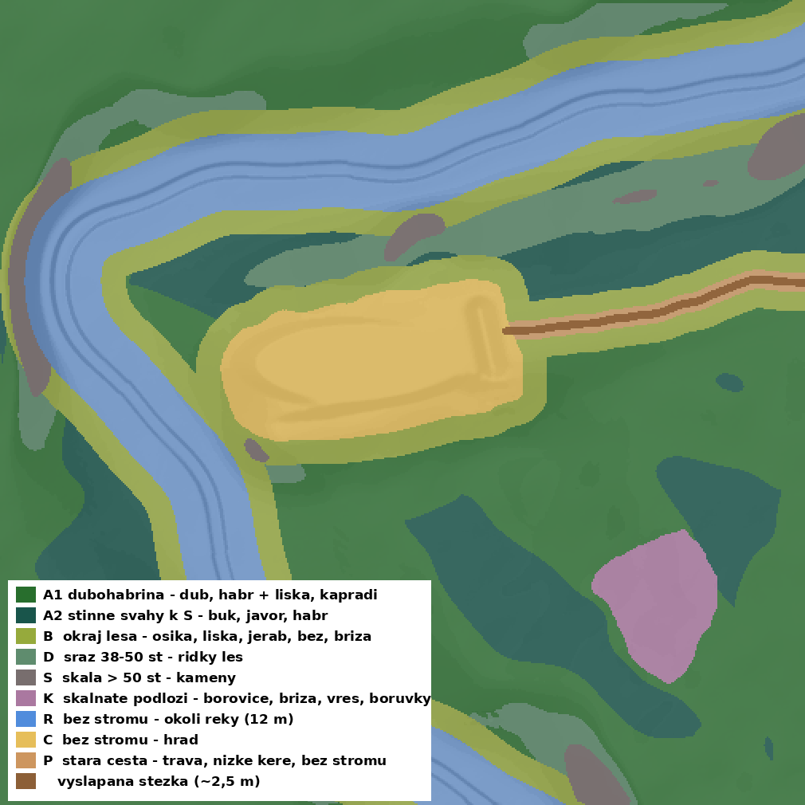
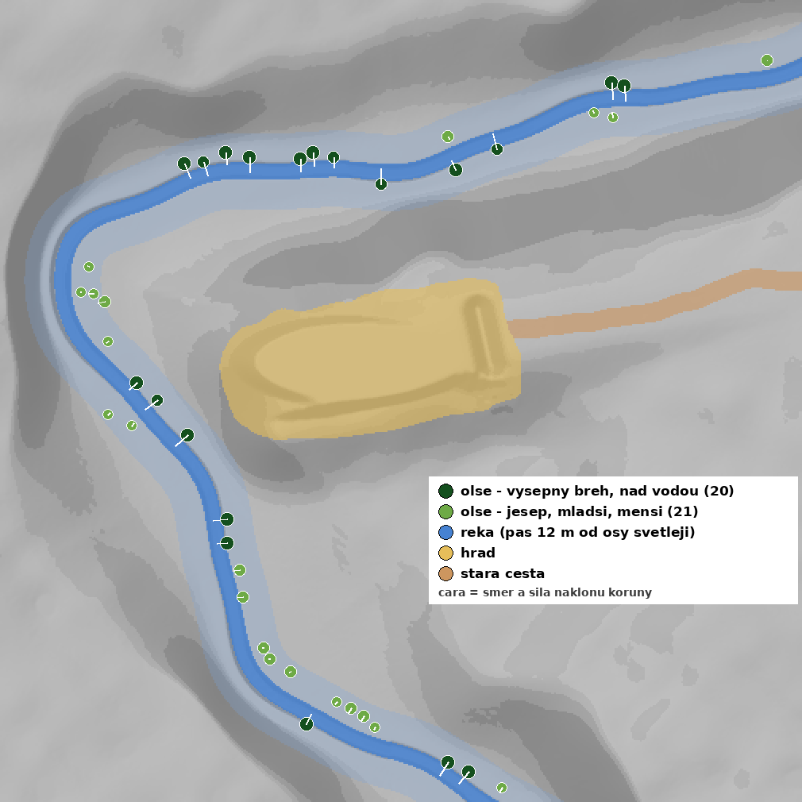

# 04 Forest – plán smíšeného lesa

Cíl: travnaté plochy mapy `LapikusPrototypeMap` pokrýt **automaticky** smíšeným lesem (dubohabřina, ve stinných polohách buk). Okolí řeky, hrad a stará cesta ke hradu zůstanou bez stromů. Na skalnatém podloží roste jen kosodřevina a keře.



## 1. Zóny

| Zóna | Kde | Plocha | Co tam roste | Hustota stromů |
|---|---|---|---|---|
| **A1 – dubohabřina** | slunné svahy, hřbet, plošiny | ~23 600 m² | dub letní, habr, javor, příměs osiky, buku, jeřábu · podrost líska, brslen, kapraď | 1 strom / ~60 m² (rozestup ~8 m) → **~390 stromů** |
| **A2 – stinné svahy k severu** | svahy obrácené k S (hlavně severní svah ostrohu nad řekou) | ~8 200 m² | buk, habr, javor, ojediněle smrk a dub · zmlazení buku a javoru, sasanka | 1 strom / ~60 m² → **~140 stromů** |
| **B – okraj lesa** | pás 8 m kolem řeky a hradu, pás kolem cesty | ~9 400 m² | osika, bříza, jeřáb, dub · líska, bez, brslen, zmlazení osiky | 1 strom / ~90 m², víc keřů → **~100 stromů** |
| **D – sráz 38–50°** | strmé svahy, výsepný břeh | ~4 000 m² | habr, dub, bříza, ojediněle borovice · líska | 1 strom / ~150 m² → **~25 stromů** |
| **S – skála > 50°** | skalní stěna pod hradem, nejprudší břehy | ~1 500 m² | bez stromů, kameny (`SM_Rock`), pár keřů | – |
| **R – okolí řeky** | do 12 m od osy toku | – | bez lesa z PCG; **olše lepkavá**, na jesepu část **vrba jíva** – skriptem podle koryta (kap. 5.1) · orobinec, rákos, netýkavka | 41 stromů |
| **C – hrad** | obrys hradu podle náčrtu (spline `PCG_NoForest`) | ~3 600 m² | bez stromů; kopřiva a bez u zdí, zmlazení jeřábu a osiky v sutích | – |
| **P – stará cesta** | od příkopu na východ k okraji mapy, ~96 m, šířka ~6 m (spline `PCG_Path`) | ~600 m² | zarostlá vozová cesta: tráva, kapraď, nízké keře, bez stromů; uprostřed vyšlapaná stezka ~2,5 m pro koně v řadě | – |
| **K – skalnaté podloží** | plocha JV od hradu podle náčrtu (spline `PCG_Rocky`) | ~1 200 m² | borovice lesní, bříza, suchá borovice, dub · vřes, borůvka, brusinka, kameny | 1 strom / ~250 m² → **~5 stromů** |

Skladba vychází ze skutečné lokality: zřícenina Lapikus nad Plenkovickým potokem (Znojemsko), přirozeně **dubohabřina**, buk jen ve stinných polohách údolí. Podíly druhů a seznam assetů jsou v `README_assets_stromy.md` kap. 2.

Zbytek ostrohu mezi hradem a řekou je teď normální les (zóny A/B), protější břeh je zalesněný.

Hodnoty jsou výchozí návrh. Všechny jsou parametry PCG grafu, takže je jde měnit bez přestavby.

## 2. Co je v projektu

| Asset | Použití v lese |
|---|---|
| `StarterContent/Props/SM_Bush` | keř – podrost, okraje (zóna B, D) |
| `StarterContent/Props/SM_Rock` | kameny – zóna S, sutě pod srázem |
| `M_Wood_Oak`, `M_Wood_Pine`, `T_Bush_*` | jen materiály a textury, ne modely stromů |

**V projektu nejsou žádné stromy ani foliage.** Stromy je potřeba stáhnout (kap. 3).

## 3. Stromy ke stažení

Podrobný výběr druhů, git strategie a návod, jak assety dostat do projektu a vyexportovat: **`README_assets_stromy.md`**.

Shrnutí:

- **Zdroj:** [Quixel Megaplants na Fabu](https://www.fab.com/sellers/Quixel%20Megaplants?is_free=1). Zdarma, Fab Standard License, **verze pro UE 5.8**.
- **Nejsou to hotové modely:** jsou to presety pro **Procedural Vegetation Editor (PVE)**. Stromy se v PVE vygenerují a exportují do `Content/Skvt/Lapikus/Vegetation/`. Teprve exporty se dávají do PCG a do `place_alders.py`.
- **Priorita A** (první verze): dub, habr, buk, javor, olše, líska.
- **Zóna K (skalnaté podloží):** místo kosodřeviny borovice lesní, bříza, suchá borovice, vřes a borůvka (Baltic Pine, Silver Birch, Dead Pine, Common Heather, Bilberry).
- **U zříceniny:** kopřivy a bez černý (Stinging Nettle, Elder).
- **Git:** zdrojové balíky do `.gitignore`, do repa jen exporty z `Vegetation/` (repo nemá LFS, limit 100 MB / soubor).

## 4. Technika: PCG (Procedural Content Generation)

PCG umístí stromy automaticky podle pravidel. Změníš-li řeku, mýtinu nebo parametr, les se přepočítá sám.

### 4.1 Příprava

1. **Edit → Plugins → Procedural Content Generation Framework (PCG)**, zapnout a restartovat.
2. Vytvořit **PCG Graph** `PCG_Forest` ve `Skvt/Lapikus/PCG/`.
3. Do levelu vložit **PCG Volume**: Location 0, 0, 2500, Scale tak, aby pokryl celý landscape (≥ 25 250 cm v X i Y). Na jeho PCG komponentu přiřadit `PCG_Forest`.
4. **Zóny ze splinů** (hrad, cesta, skalnaté podloží):
   1. Vytvořit Blueprint `BP_PCGSpline` (Blueprint Class → Actor → Add → **Spline**). Uložit do `Skvt/Lapikus/PCG/`.
   2. Vložit ho do levelu 3×, nastavit Location 0, 0, 0 a do **Tags** (Details → Actor → Tags) dát:
      - `PCG_NoForest` – hrad
      - `PCG_Path` – stará cesta
      - `PCG_Rocky` – skalnaté podloží
   3. Vybrat všechny tři a spustit **Tools → Execute Python Script → `import_zone_splines.py`**. Body se nastaví podle náčrtu (hrad a skály jako uzavřené spliny, cesta jako otevřený).
   4. Tvar pak lze dolaďovat přímo tahem bodů ve viewportu (Alt+tah = nový bod), les se přepočítá.
   - Další mýtiny / průhledy = další `BP_PCGSpline` s tagem `PCG_NoForest`.

### 4.2 Struktura grafu

```
Get Landscape Data
  └─ Surface Sampler ............ body stromů (Points/m² ~0.016, Point Extents ~300 cm)
       ├─ Difference ← Get Spline Data (Tag = PCG_NoForest, uzavřený → plocha) ... zóna C a další mýtiny
       ├─ Distance   ← Get Spline Data (WaterBodyRiver) → Filter > 1200 cm ... zóna R
       ├─ Distance   ← Get Spline Data (Tag = PCG_Path)  → Filter > 500 cm ..... zóna P (cesta)
       ├─ Get Spline Data (Tag = PCG_Rocky) → uvnitř ponechat jen 5 % bodů ....... zóna K
       ├─ Normal → sklon:  > 50° pryč (S) | 38–50° ponechat 25 % (D)
       ├─ Normal → expozice: svah obrácený k severu (normála Y < −0.35 po vyhlazení) → Zone = A2, jinak A1
       ├─ Distance od okraje mýtiny / řeky < 800 cm → atribut Zone = B
       ├─ Self Pruning ............ stromy se nepřekrývají
       ├─ Transform Points ........ rotace Z 0–360°, scale 0.8–1.25, Z −20 cm (kořeny v zemi)
       └─ Static Mesh Spawner ..... vážený výběr druhů podle atributu Zone (A1 / A2 / B / D / K)

Get Landscape Data
  └─ Surface Sampler (hustší) ... podrost: líska, SM_Bush
       ├─ stejné vyloučení (C, R, S); u cesty jen stezka < 150 cm bez keřů
       ├─ uvnitř PCG_Rocky: vřes, borůvka a zmlazení borovice místo lísky, hustěji
       ├─ Difference ← body stromů  (ne do kmenů)
       └─ Static Mesh Spawner

Get Landscape Data
  └─ Surface Sampler → sklon > 45° nebo uvnitř PCG_Rocky → SM_Rock (scale 0.5–2.0) .... sutě a kameny
```

### 4.3 Hlavní parametry k ladění

Udělat z nich parametry grafu, aby šly měnit v Details PCG Volume:

| Parametr | Výchozí | Co dělá |
|---|---|---|
| `TreeDensity` | 0.016 / m² | celková hustota stromů |
| `RiverClearance` | 1200 cm | šířka pásu bez stromů kolem osy řeky |
| `EdgeWidth` | 800 cm | šířka okrajové zóny B |
| `SlopeSparse` | 38° | od jakého sklonu les řídne |
| `SlopeNoTrees` | 50° | od jakého sklonu nejsou stromy |
| `PathClearance` | 500 cm | pás bez stromů kolem osy cesty (keře až od 150 cm) |
| `RockyTreeRatio` | 0.05 | podíl stromů ponechaných na skalnatém podloží |
| `Seed` | 1 | jiné náhodné rozmístění |
| váhy druhů | A1: dub 40 / habr 35 / javor 10 / osika, buk, jeřáb 5; A2: buk 45 / habr 25 / javor 20 / smrk, dub 5 | mix lesa (`README_assets_stromy.md` kap. 2.1) |

## 5. Ruční doladění

### 5.1 Olše podél řeky

Olše jsou rozmístěné podle toho, jak olše lepkavá u potoka opravdu roste. Body jsou v `Zricenina_olse.csv`, náhled je `Zricenina_olse_plan.png`.



Náhled ukazuje jen olše, řeku, hrad a cestu. Čára u stromu značí směr a sílu náklonu koruny nad vodu. **Zóny lesa (A, B, D, S, K, R, C, P) a jejich legenda jsou v `Zricenina_les_plan.png`** na začátku tohoto dokumentu.

| Pravidlo | Proč |
|---|---|
| Pás těsně u vody: 0,5–5 m od hrany koryta, max ~0,5 m nad hladinou | Olše potřebuje trvale vlhkou půdu, kořeny sahají do vody |
| **Výsepný (vnější) břeh:** souvislejší řada přímo na hraně, větší stromy, náklon 5–10° nad vodu | Starší stromy zpevňují podemílaný břeh a natahují se za světlem nad korytem |
| **Jesep (vnitřní břeh, náplavy):** řidší, dál od vody (6–10 m), menší a mladší stromy, téměř rovné | Náplav je mladý, stromy na něm teprve rostou |
| Skupiny po 2–6 stromech, mezi nimi mezery 10–30 m, každý břeh má vlastní rytmus | Přirozený, ne alejový vzhled |
| Rozestup min. 4 m, ne na srazu > 32°, ne v ploše hradu, na cestě a u okraje mapy | Koruny se nepřekrývají, místa pro hru zůstanou volná |

Výsledek: **41 stromů** (20 olší na výsepném břehu, 21 na jesepu – zde volitelně část vrb jív).

**Vložení do levelu:**

1. Stáhnout z Megaplants **Black Alder**.
2. Otevřít `place_alders.py` a do `ALDER_MESHES` vložit cesty k meshům olše (Content Browser → pravé tlačítko na mesh → **Copy Reference**). Ideálně 2–4 varianty.
   - Volitelně do `WILLOW_MESHES` vložit exporty **vrby jívy** (Goat Willow). Asi 35 % stromů na jesepu pak bude vrba místo olše (`WILLOW_SHARE`).
3. **Tools → Execute Python Script** → `place_alders.py`. Nic není potřeba vybírat.
4. Olše se vloží jako samostatné actory do složky **Forest/Alders** v Outlineru, s tagem `Zricenina_Alder`. Jde je posouvat a mazat ručně.
5. Opakované spuštění nejdřív smaže olše z předchozího běhu. Ruční úpravy se tím ztratí, takže skript spouštěj, jen dokud olše neladíš ručně.

Výšky Z jsou z heightmapy, 15 cm pod terénem. Pokud byl spline řeky výrazně posunut od koryta, olše ho kopírovat nebudou. V tom případě je potřeba přegenerovat (`tools`, krok 6).

### 5.2 Další detaily

- **Výhledy:** z plošiny hradu na řeku udělat průhled dalším splinem `PCG_NoForest`.
- **Stezka v materiálu:** `T_ForestZones_505.png` má v kanálu **B** vyšlapanou stezku. Do `M_Landscape_Forest_Auto` ji lze přimíchat stejně jako bahno u řeky (02_river, kap. 2): druhé `LandscapeLayerCoords` s Mapping Scale 504, Lerp na hlínu / `T_Ground_Gravel_D` ztmavený.
- **Stará cesta:** po okrajích stezky pár kamenů, vyjeté koleje lze naznačit Sculptem (Smooth / Flatten podél splinu).
- **Padlé kmeny, pařezy:** z balíku stromů, ručně u cest a na okraji mýtiny.


## 6. Výkon

- ~650 stromů + podrost je pro Nanite foliage nenáročné.
- Zkontrolovat **Cull Distance** u podrostu (keře stačí do ~80 m).
- Stíny: Virtual Shadow Maps (výchozí v UE5) zvládají Nanite foliage dobře.

## 7. Postup krok za krokem (checklist)

1. ☐ Rozhodnout, jak řešit velikost repa (kap. 3)
2. ☐ Assety podle `README_assets_stromy.md`: dub, habr, buk, javor, olše, líska (stažení + export v PVE)
3. ☐ Zapnout plugin PCG
4. ☐ Vložit PCG Volume a 3× `BP_PCGSpline` (hrad, cesta, skály), spustit `import_zone_splines.py`
5. ☐ Graf `PCG_Forest` – nejdřív jen stromy zóny A, pak vyloučení R, C a P
6. ☐ Sklon (D, S), okrajová zóna B, skalnaté podloží K
7. ☐ Podrost a kameny
8. ☐ Ladění parametrů, procházka postavou (Play)
9. ☐ Olše (`place_alders.py`) a ruční detaily

## Soubory

| Soubor | Obsah |
|---|---|
| `README_forest.md` | tento plán |
| `Zricenina_les_plan.png` | mapa zón lesa s legendou (stejný výřez jako `Zricenina_preview_orez.png`) |
| `import_zone_splines.py` | nastaví spliny `PCG_NoForest`, `PCG_Path`, `PCG_Rocky` podle náčrtu |
| `Zricenina_les_zony.csv` | body těchto splinů (X/Y/Z v cm) |
| `T_ForestZones_505.png` | maska zón přes celý landscape: R = bez stromů (řeka, hrad, cesta), G = skalnaté podloží, B = vyšlapaná stezka |
| `README_assets_stromy.md` | výběr druhů z Megaplants, stažení z Fabu, export v PVE, git strategie |
| `place_alders.py` | UE skript: vloží olše podél řeky |
| `Zricenina_olse.csv` | 41 olší: X/Y/Z, yaw, náklon, směr k vodě, scale, břeh |
| `Zricenina_olse_plan.png` | náhled rozmístění olší (bez zón lesa; legenda zón je v `Zricenina_les_plan.png`) |
| `nacrt_zony.png` | tvůj náčrt (červená = hrad, oranžová = cesta, fialová = skály) – zdroj pro přegenerování zón |
